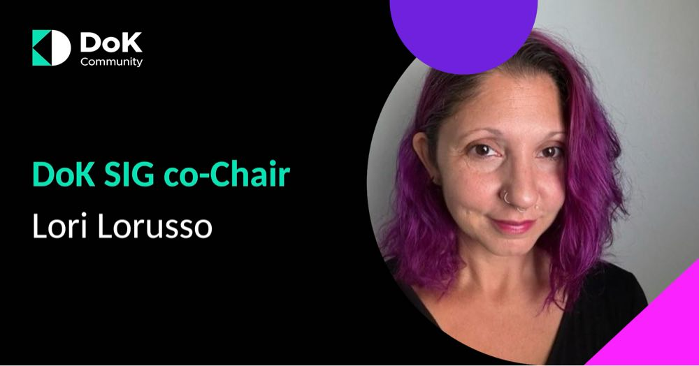

We are thrilled to announce that Lori Lorusso, Head of Community at Percona, has been appointed as co-chair for the Data on Kubernetes Special Interest Group (SIG). This appointment marks an exciting new chapter for our community, and we're confident that Lori's extensive experience and passion will drive significant advancements in our mission.

Lori brings a wealth of expertise in community building, developer relations, and open-source leadership to this role. Her impressive track record includes:

- 2023 Marketing Chair of the Cloud Native Computing Foundation (CNCF)
- 2022-2024 Outreach Committee Chair for the Continuous Delivery Foundation (CDF)
- Taking an active role within the Open Source Security Foundation (OpenSSF) outreach committees
- Co-hosting the CD Pipeline with TechstrongTV
- Speaker at several conferences including: KCDC, CodeMash, LF Member Summit, OpenSSF Day, Fosdem and more.

Known for her ability to forge strong relationships within tech communities, Lori has consistently demonstrated her commitment to connecting developers with the right tools, mentors, and support systems they need to thrive. Her contributions extend beyond organization and leadership; Lori has also shared her insights through community-focused articles published in respected tech publications such as The New Stack, VMBlog, and eWeek.

We look forward to the fresh perspectives and innovative ideas that Lori will bring to her role as co-chair. Her appointment reinforces our commitment to fostering a vibrant and supportive community around Data on Kubernetes, and her extensive experience in various open-source foundations and tech communities will be a significant asset to our group.

Please join us in welcoming Lori Lorusso to her new role. We're excited about the future of our SIG under her co-leadership and the valuable contributions she will make to the Data on Kubernetes community!
