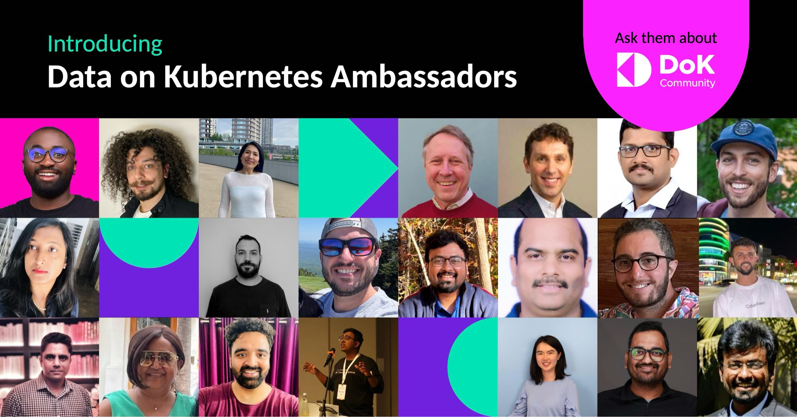

We put out the call for Data on Kubernetes community members to submit applications for the Ambassador program, and you responded. We had an overwhelming response of amazing candidates. Several existing ambassadors are returning and will be joined by a roster of new DoK experts.

The DoK Ambassador program started a year ago as a way to acknowledge the leaders in the DoK Community. These are individuals who have a thirst for sharing their knowledge and helping others in the community. This year is no different. The adoption of running data workloads on K8s has continued to grow and, with that, an ever growing number of DoK experts and evangelists.

We are thrilled to announce the 2024/2025 roster of DoK Ambassadors, each bringing a unique perspective and expertise. Please join me in congratulating them.

- Alex Lines (returning)
- Bhavin Shah
- Danish Khan
- Divine Odazie
- Edith Puclla (returning)
- Gabriele Bartolini (returning)
- Ganesh Kumar Kasiviswanathan (returning)
- George Hantzaras
- Itamar Marom (returning)
- Jonathan Battiato
- Lu Qiu
- MD Shahriyar Al Mustakim Mitul
- Nandini Taneja
- Olyvia Rakshit (returning)
- Ravi Yadav
- Robert Hodges (returning)
- Ryan Wallner
- Shubham Pampattiwar
- Steve Sklar
- Vinod Kumar

Thank you to all that applied and to those ambassadors who participated in the program this past year. The DoK community includes individuals from all over the globe with a common interest in making running stateful workloads on Kubernetes, more accessible and the new norm. We appreciate all contributions to the community, big or small.
