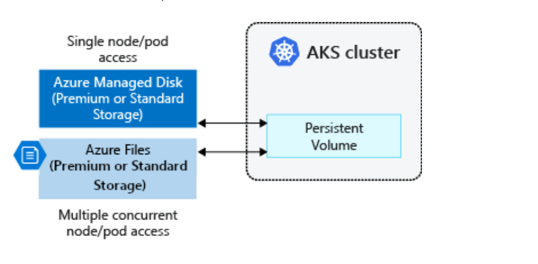
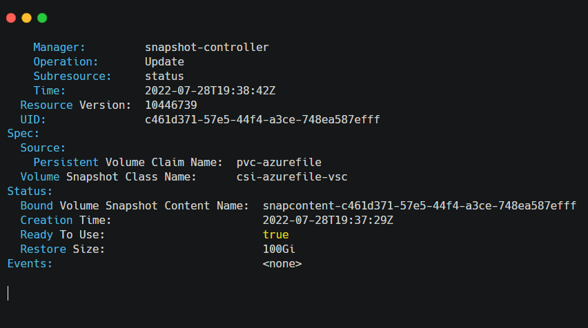
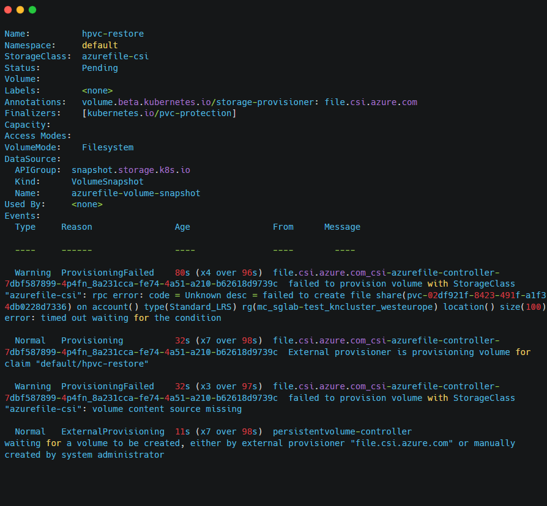

If you are considering Azure Files as the persistent storage for your Azure Kubernetes Service (AKS) applications, there are important considerations for backup and recovery with implications on how you can migrate data for Dev, Test, and Staging. This article outlines these data management considerations in detail and how to work around Azure Files CSI driver limitations to achieve feature parity with using Azure Managed Disks.

Before we walk you through how to automate Azure Files restore in AKS, let’s quickly touch on some of the important underlying Kubernetes data storage concepts.

# Persistent Volume

A Persistent Volume (PV) is a storage resource created and managed by the Kubernetes API that can exist beyond the lifetime of an individual pod. This is often used in conjunction with the aptly named StatefulSets. In AKS, you can use Azure Disks or Azure Files to provide the Persistent Volume. The choice of Disks or Files is often determined by the need for concurrent access to the data from multiple nodes or pods (lean towards Files) or the need for a performance tier (lean towards Disks).

# StorageClass

A Persistent Volume can be *statically* created by a cluster administrator or *dynamically* created by the Kubernetes API server. Dynamic provisioning uses a *StorageClass* to identify what type of Azure storage needs to be created.

# CSI Drivers

The [Container Storage Interface](https://kubernetes.io/blog/2019/01/15/container-storage-interface-ga/) (CSI) is a useful standard for exposing arbitrary block and file storage systems to containerized workloads on Kubernetes. By using CSI, storage vendors can now write, deploy, and iterate plug-ins to expose new or improve existing storage systems in Kubernetes. Using CSI drivers vs to replace in tree volumes avoids having to touch the core Kubernetes code and wait for its release cycles.

Starting in Kubernetes version 1.21, AKS uses CSI drivers only and by default. Existing in-tree volumes still work, but AKS internally routes all operations to a CSI driver. The default class is managed-csi. The following explanation of each AKS CSI storage class is sourced from [AKS documentation](https://docs.microsoft.com/en-us/azure/aks/concepts-storage):

|  |  |
| --- | --- |
| **Permission** | **Reason** |
| managed-csi | Uses Azure StandardSSD locally redundant storage to create a Managed Disk. The reclaim policy ensures that the underlying Azure Disk is deleted when the persistent volume that used it is deleted. The storage class also configures the persistent volumes to be expandable, you just need to edit the persistent volume claim with the new size. |
| managed-csi-premium | Uses Azure Premium locally redundant storage to create a Managed Disk. The reclaim policy again ensures that the underlying Azure Disk is deleted when the persistent volume that used it is deleted. Similarly, this storage class allows for persistent volumes to be expanded. |
| azurefile-csi | Uses Azure Standard storage to create an Azure File Share. The reclaim policy ensures that the underlying Azure File Share is deleted when the persistent volume that used it is deleted. |
| azurefile-csi-premium | Uses Azure Premium storage to create an Azure File Share. The reclaim policy ensures that the underlying Azure File Share is deleted when the persistent volume that used it is deleted. |

# CSI Snapshots

Apart from provisioning PVs, a key functionality in CSI drivers is to enable snapshots and recoveries. Both Azure Managed Disks and Azure Files support CSI snapshots of Persistent Volumes. However, not all CSI drivers are created equal. While they all support provisioning, several cloud and storage vendors do not support CSI for some of the more advanced functionality, such as resizing, recovery, and snapshots. Even Microsoft itself supports CSI drivers more extensively for Azure Managed Disks when compared to Azure Files.

# Azure Files Snapshots

The Azure Files CSI driver supports creating snapshots of persistent volumes and the underlying file shares. You can describe the snapshot by running the following command:

**kubectl describe volumesnapshot azurefile-volume-snapshot**

The output of the command resembles the following example screenshot, and you can see the “Ready to Use” flag set to true at the bottom of the response:

If the **kubectl describe volumesnapshot** command fails for any reason, you can see the “Ready to Use” flag set to False at the bottom of this response:

The issue with the Azure File CSI driver is that it does not support automated mounting or recovery from these AKS File snapshots.  The following output shows the restore failure when it is attempted through the CSI driver:          

# Manual Restore from Azure Files Snapshots

As we can see above – and from the [Azure Files CSI documentation](https://docs.microsoft.com/en-us/azure/aks/azure-files-csi) – restoring from Azure Files CSI snapshots is not supported by Azure CSI driver. Snapshots can be restored manually from an Azure portal or from the CLI, as outlined [in Azure's documentation](https://docs.microsoft.com/en-us/azure/storage/files/storage-snapshots-files) (section “Copying data back to a share from share snapshot).

However, any manual workaround is too much of a headache in the automated world of Kubernetes, basically making Azure File snapshots fairly useless in a CI/CD environment for supporting Dev, Test, and Staging environments.

# Automated Restore from Azure Files Snapshots

There is a way to automate the restoration of Azure Files CSI Snapshots through native integration with your Azure accounts. A backup application [with native Azure integration](https://cloudcasa.io/blog/automating-azure-files-restore-in-aks/), such as CloudCasa, can inventory the Azure accounts to query a list of all clusters and other dependent resources and catalog how each cluster is configured.

Native integration cuts down the amount of work needed to automate Azure Files restores by a large amount. One just needs to query the snapshotID of each Azure Files CSI snapshot and find the corresponding snapshot by directly querying the Azure Files API. Once the snapshot is matched, one can now backup (copy) its contents to another region and, more importantly, recover it to a new volume, as and when needed.

During recovery from snapshots, the backup application can automatically identify the snapshot that has the content a user is trying to recover. It can then dynamically provision a new PV through the Azure Files CSI driver and copy its contents through Azure Files Copy option. For application consistency, this operation would run as a pre-restore task before restoring resources that are potentially dependent on this PV. Both the automated copy and recovery operations can also be orchestrated through APIs.

# All CSI Drivers are Not Yet Equal

As you can see, not all CSI drivers have the full functionality one would expect, and some cloud providers even consider automated recovery a luxury. There are many CSI differences in Kubernetes data storage solutions, with CSI snapshot behaviors being a major pain point for data protection solutions. While it was a satisfactory exercise to solve this Azure Files snapshot issue quickly through native integration Azure, that is not possible with most storage vendors. For example, we participated in a lengthy process with the Longhorn v1.3 community to help test [CSI snapshots for backup and recovery](https://cloudcasa.io/blog/using-longhorn-snapshots-for-backup-and-recovery/), and we are working with or waiting on multiple other Kubernetes storage providers and their CSI drivers to fully implement CSI snapshots.

The good news is that if you are working with a public cloud Kubernetes service and a SaaS backup solution, workarounds can be delivered quickly.  But if you are running into any issues with Kubernetes PV snapshots and data recovery, check out our [automated Azure Files restore,](https://cloudcasa.io/blog/automating-azure-files-restore-in-aks/) also feel free to reach [out to me](mailto:casa@cloudcasa.io) if you have any questions!

*This guest post was originally published on [CloudCasa's blog](https://cloudcasa.io/blog/automating-azure-files-restore-in-aks/) and edited for the DoK blog by Mike Miracle.*
