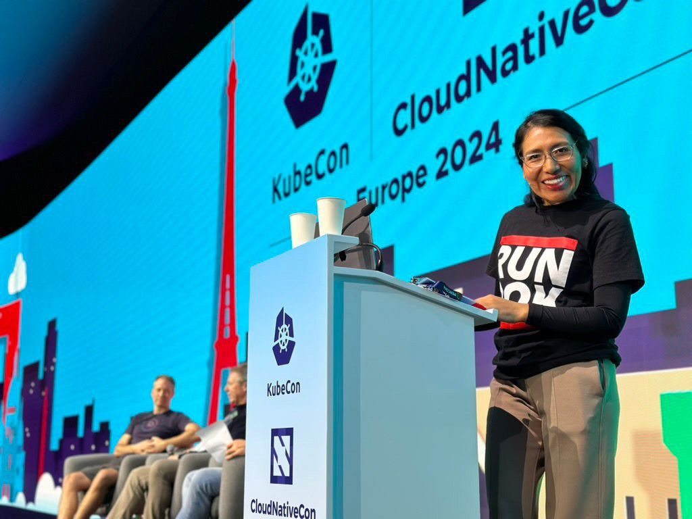
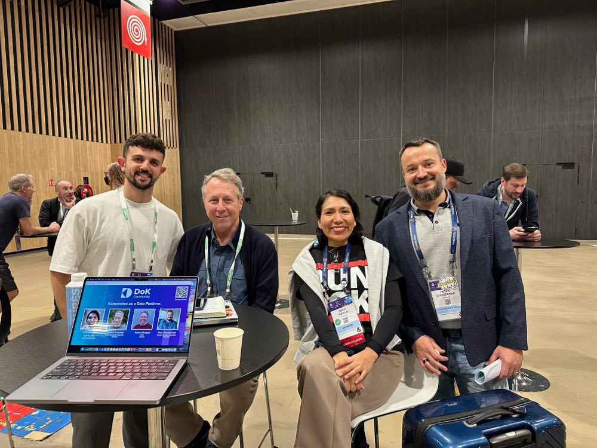

The Data on Kubernetes Community (DoKC) is thrilled to announce that we will be accepting applications for the [DoKC Ambassadors Program](/ambassadors/program/) starting May 1st. The DoK Ambassadors program was created to acknowledge and empower members of the community that have demonstrated expertise in DoK ecosystem and a level of enthusiasm for participating in the community.

## Important Dates

**Accepting Applications**: May 1 - May 31
**Acceptance Notifications**: June 17th
**Ambassador Community Announcement**: July 1

## What are we looking for?

We are looking for people that have something to contribute to the community. Do you love talking about DoK? Are you writing content related to DoK? Are you hosting local meetups in your community? Are you engaging in DoK related discussions on Slack, LinkedIn, etc? We want to hear about it! We are looking for enthusiastic individuals who are helping to move the DoK ecosystem forward.

## Why become a DoK Ambassador?

As an ambassador, you can amplify your voice in the Data on Kubernetes Community. DoKC ambassadors are empowered with more access and responsibility in the community. They are given access to a private Ambassador slack channel and are invited to monthly Ambassador meetings. You will work directly with DoK staff to help push initiatives that help the DoKC. It’s also a lot of fun! You’ll meet other [enthusiastic members](/ambassadors) of the community and build relationships.

## What do we expect from our Ambassadors?

As a DoK Ambassador, we do expect that you will first and foremost abide by the community Code of Conduct. We insist that you treat people with respect at all times. We expect you to continue to participate in at least one of several different DoKC related activities. As an official representative of the community, we expect you to always create a welcoming environment for new community members. We also expect you to have fun! We understand that you are volunteering your time. We don’t want this to feel like one more job to do. We want people that genuinely like sharing and building a community.

## How do you apply?

To apply, you just have to fill out a form and tell us about yourself. Be as descriptive as possible. The more we know, the better we can evaluate your application. Don’t be afraid to brag about yourself.

*The Ambassador Program is now DoK Pilots.* [Apply to be a Pilot](/pilots/)
