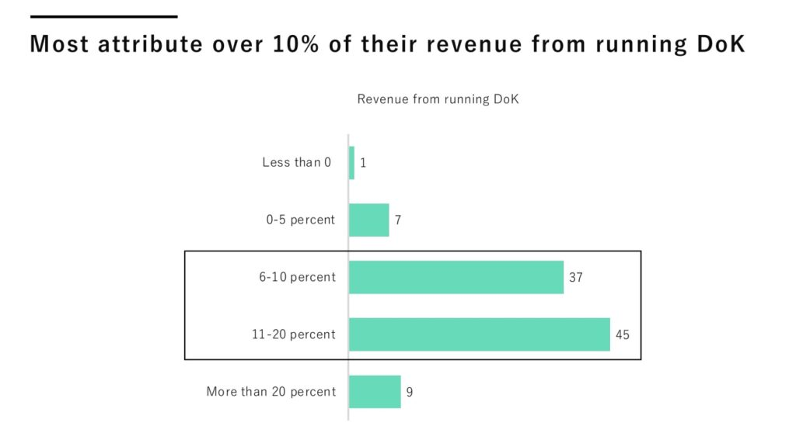
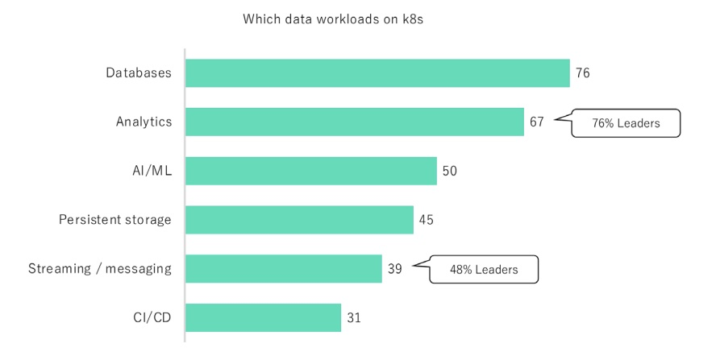
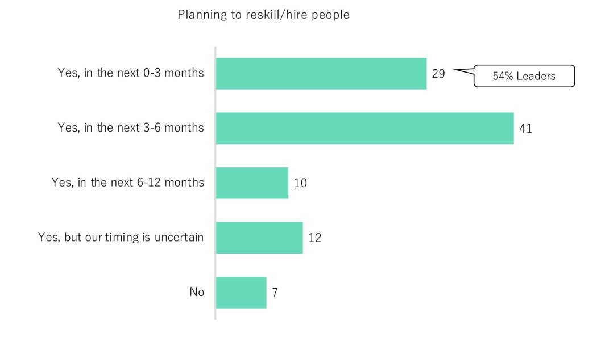

Data applications empower organizations to create new business models and transform industries, and Kubernetes is increasing the velocity with which they can be deployed. Last [year's report found](/blog/first-data-on-kubernetes-report-published/) that the appetite for Data on Kubernetes (DoK) is strong, with 90% of respondents believing that Kubernetes is ready for stateful workloads and a large majority of respondents (70%) running them in production.

[This year’s report found](/data-on-kubernetes-2022-report/) that running data on Kubernetes benefits the whole organization, not just engineering. Data on Kubernetes has a transformative impact on organizations. Most of them attribute over 10% of their revenue to running DoK. One-third saw their productivity increase twofold. These benefits are reported by all organizations, no matter their tech maturity.

Databases remain the most run workload on Kubernetes, but organizations are increasingly running more complex workloads such as Analytics (67%) and AI/ML (50%). And they experience high satisfaction doing it. However, Day-2 operations remain a significant challenge, and organizations turn to Kubernetes operators to address it. Security is the most important criterion when picking an operator.

Organization’s increased adoption of DoK translates to a need for more talent. Lack of qualified talent ranked second on the list of top challenges, and 41% of respondents plan to upskill or hire DoK talent within the next three to six months.

Our report is based on the answers of over 500 individuals whose organizations are currently

using data on Kubernetes. Their roles include CIOs and CTOs, VPs and Directors of IT, Software and Site-reliability engineers, Database administrators, and Data engineers – the targeted demographic ratio is practitioners (~42%), executives (~37%), and managers (~20%).

The full report – funded by [DoKC sponsors](/sponsors/) – is available here [https://dok.community/data-on-kubernetes-2022-report/](/data-on-kubernetes-2022-report/)
