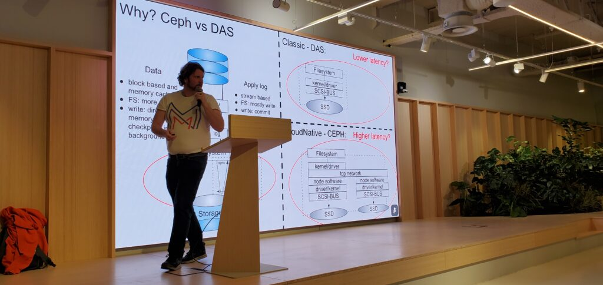
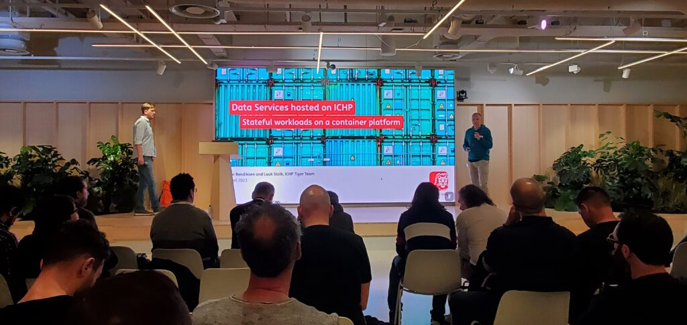
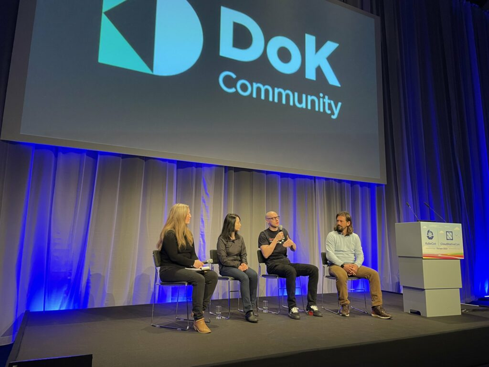
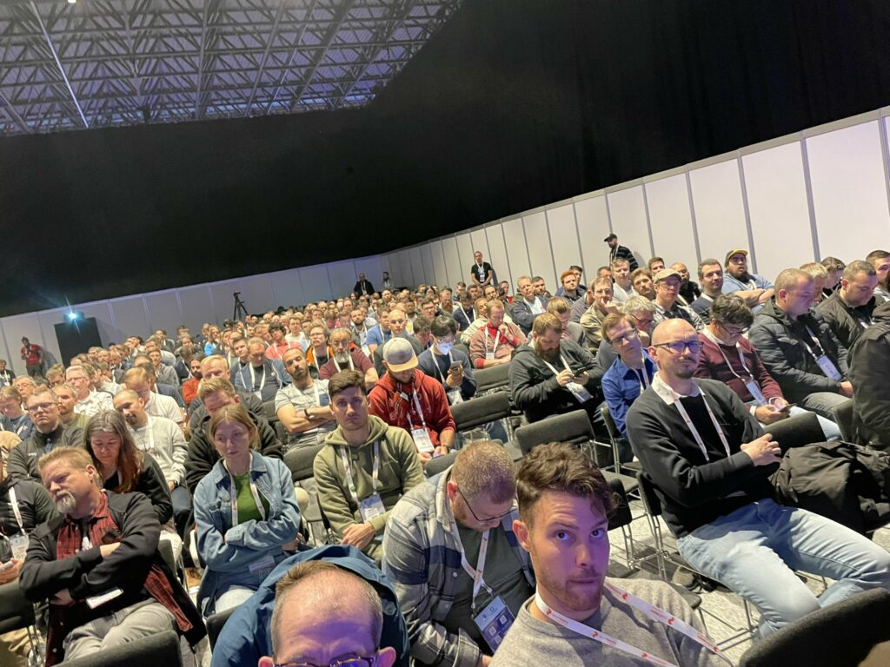
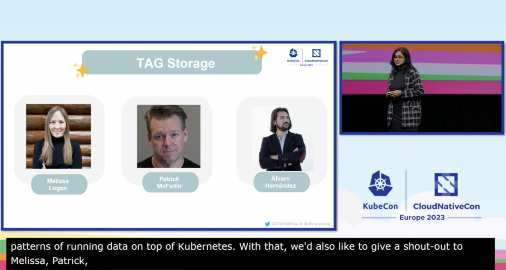

*By Melissa Logan*

We had an eventful and rewarding week with the Data on Kubernetes Community at KubeCon Europe in Amsterdam. From meetups to panels to hallway conversations, it was energizing and fulfilling to see how the DoKC came together to learn, share, and grow together.

**DoK Community Meetup**

On Tuesday, April 18, financial platform company [Adyen](https://www.adyen.com/) opened its Amsterdam office to the DoK Community for our local meetup. Over 100 community members met in person to network and hear open source leaders speak about their experiences with data on Kubernetes.

[Sebastian Mannem](https://www.linkedin.com/in/smannem/) shared his experiences helping the Dutch government manage databases and other data workloads on Kubernetes. [Tor Bendiksen](https://www.linkedin.com/in/torbendiksen/) and [Luuk Stolk](https://www.linkedin.com/in/luuk-stolk-6178946/), lead engineers for the ING Container Hosting Platform team, discussed the creation of their own self-service DoK cloud platform for global bank [ING](https://www.ing.com/Home.htm).

**KubeCon + CloudNativeCon Panel**

On Thursday, the DoKC and CNCF Storage TAG hosted a panel about the Kubernetes operator landscape (watch the replay [here](https://youtu.be/TmDdkBPW_hI)). The DoKC had a lot to contribute to this conversation. Our 2022 DoK annual [survey](/data-on-kubernetes-2022-report/) showed us that Day 2 operations are one of the biggest challenges faced by DoK users.

From this feedback, we created the DoK Operator SIG at the end of 2022 (#sig-operator on DoK [Slack](http://dokcommunity.slack.com)). With the SIG, we bring the industry together to discuss solutions to common end user challenges. Our work through the DoK Operator SIG allowed us to share some valuable insights during the panel.

We discussed the following topics:

- Operators are crucial for Day 2 operations, but they have challenges. End users cite a lack of interoperability, lack of integration with existing tools, and varying degrees of quality that stems from a lack of standards (read more in our [report](/data-on-kubernetes-2022-report/)) and extend the evaluation process for end users.
- Our 2022 [survey](/data-on-kubernetes-2022-report/) showed that most organizations are using at least 20 operators, and they expect operators to perform at a very high level. Using the [Operator Framework capability model](https://operatorframework.io/operator-capabilities/) as a reference (levels I-V), organizations expect operators to work at levels the highest levels of IV-V.
- We discussed whether the Operator Framework capability model, written many years ago when Persistent Volumes were new to Kubernetes, accurately describes the ways that data workloads can and should be managed. End users have been running data workloads for many years now and the definitions may require a rethink.
- Security is the number one criterion that end users cite for evaluating operators. Panelists discussed what functionality is provided by operators, what Kubernetes handles, and how this interoperates with other tools in the cloud-native ecosystem.
- After covering the challenges felt by end users, panelists shared solutions being developed in the DoK Operator SIG including:
  - A Databases on Kubernetes whitepaper we’re drafting in collaboration with the CNCF Storage TAG. It’s in the final stages of review and will be published in May.
  - An [Operator Feature Matrix](https://github.com/dokc/operator-feature-matrix) (OFM), a standardized and vendor-neutral feature comparison matrix currently focused on database operators. Currently under discussion; contributions welcome.
  - An Operator Security and Hardening Guide intended to define security issues for database operators and best practices to solve them. Currently under discussion.

The challenges we highlighted in the panel were understood and felt by attendees. After the talk, multiple end users shared similar concerns. One user from the Dutch government shared his struggles with comparing and evaluating operators that would work best in his environment due to poor documentation and a lack of comparison tools.

**KubeCon + CloudNativeCon Keynote Shout Out**

I was thrilled to see DoK Community members recognized during Thursday’s conference keynote. [Patrick McFadin](https://www.linkedin.com/in/patrick-mcfadin-53a8046/), [Álvaro Hernández Tortosa](https://www.linkedin.com/in/ACoAAAWuXFUBPkB6zg-grS-Em4wkxTatNjXYDqk?miniProfileUrn=urn%3Ali%3Afs_miniProfile%3AACoAAAWuXFUBPkB6zg-grS-Em4wkxTatNjXYDqk), and I were recognized for our collaborative efforts with Cloud Native Computing Foundation’s Storage Technical Advisory Group (TAG) for the Databases on Kubernetes Whitepaper (coming this May).

**Up Next with the DoKC**

If you’re local to the Bay Area, our community members will host the first official [DoK Bay Area meetup](https://bit.ly/3LlRklH). There will be end-user talks, food, drinks, and plenty of opportunities to network with fellow DoKCers. The event will take place on May 17, 2023, 6-8 pm PT. To register and learn more, [check out the event page](https://bit.ly/3LlRklH).

We also launched a new monthly Town Hall virtual event series, designed to bring the community together to learn, connect, and find ways to participate. Our first Town Hall event will feature a DoK case study with Comcast and a look at DoK + Apache Spark with Holden Karau, Spark Committer and Open Source Engineer at Netflix. We will also hold community discussions and make room for your DoK-related questions. [Register here.](https://bit.ly/41layNz)

KubeCon was abuzz with DoK-related conversations. Thanks to everyone who made this event special. We look forward to seeing you at the Town Hall in May!

**Join Us**

**Data on Kubernetes Community**

[Website](/) | [Slack](http://dokcommunity.slack.com) | [LinkedIn](https://www.linkedin.com/company/data-on-kubernetes-community/) | [YouTube](https://www.youtube.com/channel/UCUnXJbHQ89R2uSfKsqQwGvQ) | [Twitter](https://twitter.com/DoKcommunity)

**Operator SIG**

#sig-operator on [Slack](http://dokcommunity.slack.com) | Meets every other Tuesday

**Bay Area Meetup**

May 17, 6-8 PM PDT | Details + RSVP: [https://bit.ly/3LlRklH](https://t.co/iT2nz4BeZY)

**Virtual Town Hall**

May 18, 9-10 AM PDT | Details + RSVP: [https://bit.ly/41layNz](https://t.co/Nb1oCp3Swz)
