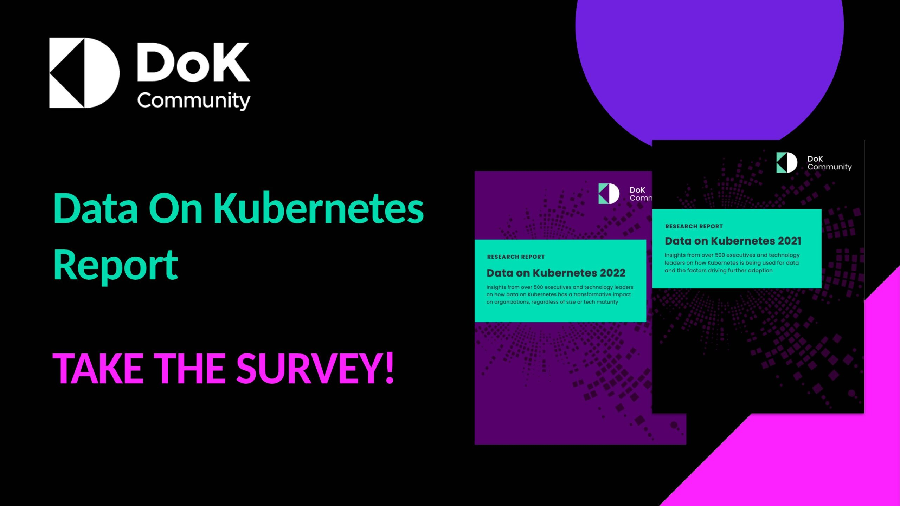

The Data on Kubernetes (DoK) Community is conducting its annual survey to understand the technology issues and trends for running data and stateful workloads on Kubernetes. This year’s survey will focus on DoK ecosystem technologies and AI/ML workloads. We invite you to be [part of this year's survey](https://community.us1.list-manage.com/track/click?u=69b500056de7204820b34995c&id=ee5a873372&e=fae8ffb71d) and contribute to the collective knowledge of our community.

Our previous reports have revealed key insights from business executives and technology leaders using DoK. The inaugural report found that 90% of respondents believed Kubernetes was ready for stateful workloads, with 70% already running them in production. Our most recent report showed even more impressive results, with 83% of respondents attributing over 10% of their revenue to running data on Kubernetes.

These findings underscore the transformative impact of DoK on organizations of all sizes and technical maturity levels. From significant productivity gains to direct impacts on revenue growth, market share, and profit margins, the benefits of running data on Kubernetes have been clear and substantial.

Your participation will help us further identify emerging trends, highlight common challenges, and showcase innovative solutions in the DoK space. Whether you're just starting your DoK journey or you're a seasoned practitioner, your experience and insights are crucial.

[Take the Survey](https://community.us1.list-manage.com/track/click?u=69b500056de7204820b34995c&id=ee5a873372&e=fae8ffb71d)
