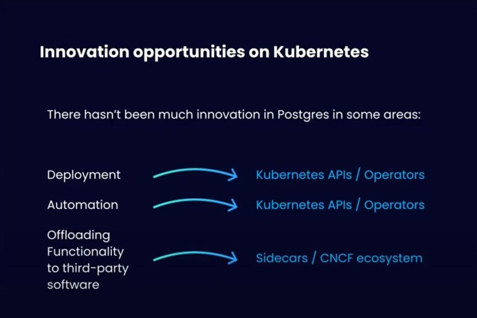
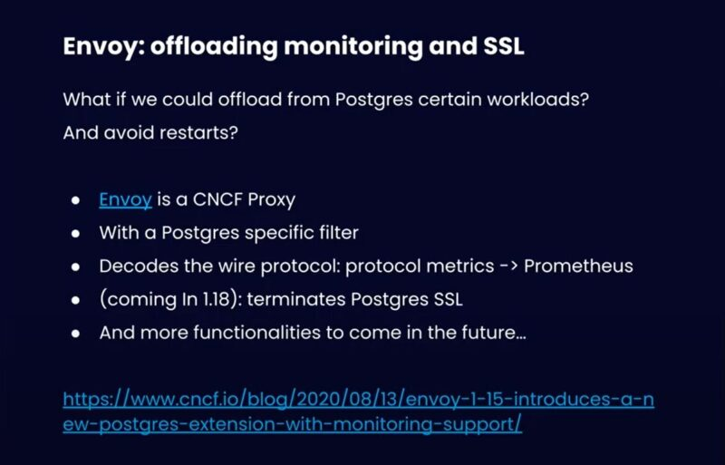
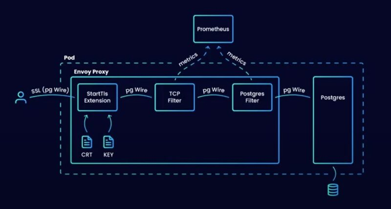
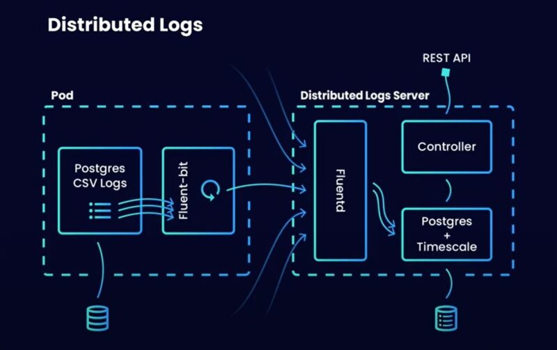
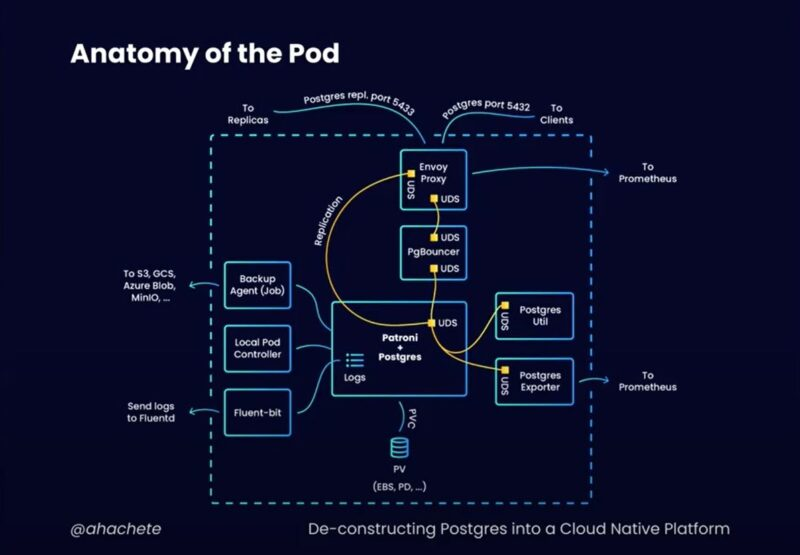
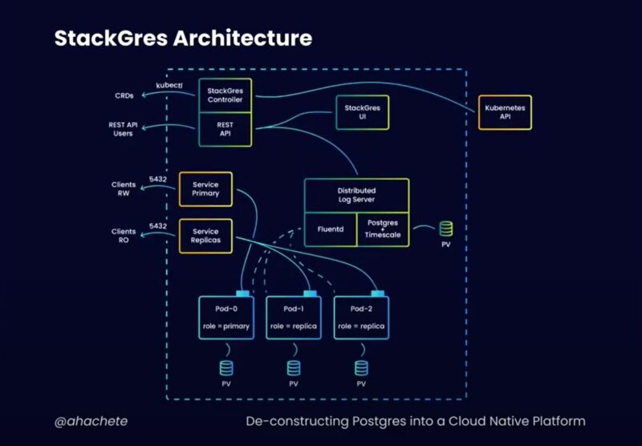
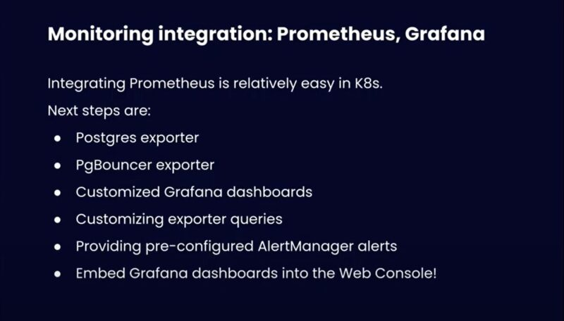
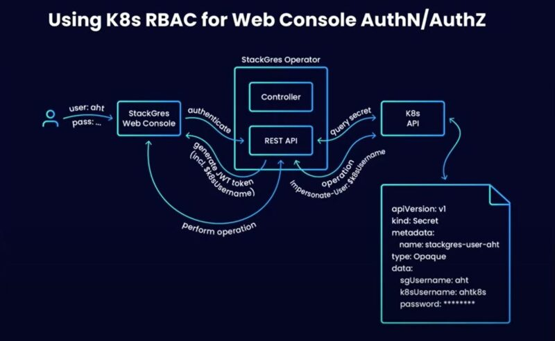
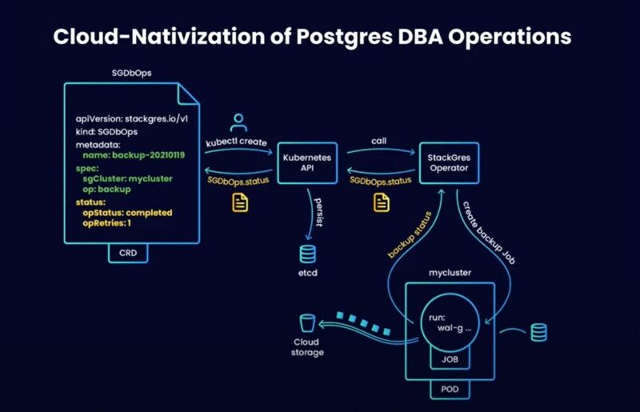

Postgres has been around for a long time in the DB space. Known to be a very reliable and sturdy technology even considered boring to some. But we were lucky enough to have Álvaro Hernández on to talk to us about Postgres innovations that are coming our way. If you want to re-watch the original click [here](https://www.youtube.com/watch?v=u32tJexk1QM). If you don’t have time, give this article a read.

## **The protagonist:**

Álvaro is the founder and CEO of OnGres which essentially means “on Postgres”. Apart from offering professional services like support and training one of their main focuses is R&D. They try to actively innovate on Postgres. Apart from community work of which he is an active member of. Álvaro has also founded a nonprofit in Spain to promote and develop Postgres, they organize a conference every year in Ibiza, [don’t miss it](https://pgibz.io/). He's also an AWS data hero.

## **How Álvaro got started with Kubernetes**

Álvaro got started with Kubernetes the same way many people do, by trying to solve a problem. Postgres is very easy to download and run on your local machine, but it's a very different story when we're talking about running Postgres in production at the enterprise level. He quickly saw that there was a need for automation and finding a way to lower the time of installation and management of Postgres in different environments. Once Álvaro and his team discovered Kubernetes, this powerful orchestrating system that will offload the complexity of setting up, managing, configuring and implementing enterprise scale Postgres environments they've never looked back. And now they have developed a software stack [StackGres](https://stackgres.io/), to run Postgres on Kubernetes the easy way.

## **Why postgres?**

Posgres is rock solid, reliable it just won’t let you down. Take it from Kelsey Hightower.

Even though Alvarado agrees with Kelsey Hightower he also wants to make clear that even though technology can be boring and reliable at its core, it can still innovate and that's what he and his team work tirelessly to do.

## **Innovation opportunities**

Postgres has grown in many areas, but there are some core areas that Postgres hasn’t such as deployment and automation. There should be ways that engineers that leverage Kubernetes to use full Postgres functionalities without knowing the in’s and out’s of the technology. This is how they plan on adjusting that.

## **Innovation agenda**

Going about the idea of innovating Postgres in six key areas.

## **Envoy: offloading monitoring and SSL**

There are many upsides to taking workloads like monitoring for example and running them elsewhere. You can free up CPU by offloading CPU-heavy workloads like SSL. Let Envoy take the monitoring and SSL task and let Postgres focus on the boring part.

How it would looks:

## **Distributed logs:**

Much needed when you are troubleshooting a 16 node Postgres cluster.

| **Main features** | **Timescale usage** |
| --- | --- |
| Postgres, Patroni logs (pgBouncer:WIP) | Open Source (Apache 2) version |
| Multi-tenant: all pods from one of more clusters | Partitions the logs space by timestamp |
| Query with SQL or via the web console | Provice support for partition pruning (log lifecycle) |

## **Init-less containers. Sidecars. Anatomy of the pod. StackGress architecture**

A container is not a slim vm, there is no need to take your Postgres vm put it into a 1 GB container and run it. There are better ways, this is a better way.

**And this is what your architecture could look like**

**Monitoring Integration: Prometheus, Grafana**

## **Using K8s RBAC for Web Console AuthN/AuthZ**

There aren’t many Web UIs for Postgres cluster management. And instead of having an external auth pool. Postgres is going to use the existing k8s RBAC and alongside the StackGres web UI authenticate users that way.

## **Cloud-Nativization of Postgres DBA Operations**

One of the goals is to widen the Postgres user base, but not too many people are Postgres experts. To manage a production Postgres cluster you need a lot of expertise, but of course many of the tedious maintenance tasks could be automated. So here, there have tried to take the most frequent operations and automate them. Now all of your automated tasks can be a YAML file away.

## **Q&A**

- **Do you integrate Patroni into the StackGres operator?**

- - Yes.

- **What could be the challenges for making a Postgres upgrade automation?**

- - It really depends on the automation that you are trying to make. The ones that they are working on now are the easily repeatable, and you can easily write and algorithm for. More complicated automations will come.

- **What is the performance overhear when running Postgres in Kubernetes?**

- - When running Postgres in containers the change in performance deviation is almost negligible.

- **Can you elaborate on  the approach of the operator hierarchy, instead of having one operator to manage everything, how do you split your operators and what benefits do you see in that approach?**

- - The operator was initially built in a well known Kubernetes pattern (controller and one or more series). But they soon found out that there were certain operations that might better be performed by other components. The REST API needed to at some point connect to the Kubernetes API directly and a reconciliation cycle was used to create this connection.

## **The get your hand on the Art of Post**:

[The Art of PostgresQL](https://theartofpostgresql.com/)

Enter promo code: dok21 to get 21% discount.

## **To get involved with the Postgres community you can find them at:**

- slack.stackgres.io
- discord.stackgres.io
