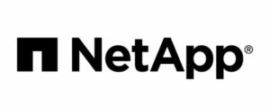
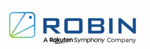

DoK Day – happening next October 24th – is where the industry meets to forge relationships, share best practices, and use cases about running data on Kubernetes. We have a great lineup of 15+ talks, check out the schedule [here](/dok-day-north-america-2022/) 👈

You will learn how ML startup A3Data built its Big Data stack on top of Kubernetes, and why the sheet metal and Healthcare industries are also surfing the DoK trend. We also host musical performances, art, poetry, and interactive quizzes to make it a memorable event. The best part of it? You can attend [remotely for free by registering here](/dok-day-north-america-2022/)!

DoK Day will be colocated – and our first hybrid event – with KubeCon NA in Detroit, Michigan. We look forward to seeing you, Bart has been training hard and is ready!
> Just a few more weeks before we hit the ground running in Detroit for DoK Day!
>
> The schedule is up, and the registration for in-person/online is flowing.

Sign up- <https://t.co/W9ouKSF791>

Shoutout to our sponsors [@NetApp](https://twitter.com/NetApp?ref_src=twsrc%5Etfw) [@CloudCasa](https://twitter.com/CloudCasa?ref_src=twsrc%5Etfw) [@anynines](https://twitter.com/anynines?ref_src=twsrc%5Etfw) [@Robin4K8S](https://twitter.com/Robin4K8S?ref_src=twsrc%5Etfw) [#dokday](https://twitter.com/hashtag/dokday?src=hash&ref_src=twsrc%5Etfw) [pic.twitter.com/zSK2YtWt08](https://t.co/zSK2YtWt08)

— Data on Kubernetes Community (@DoKcommunity) [October 4, 2022](https://twitter.com/DoKcommunity/status/1577262171620528130?ref_src=twsrc%5Etfw)

DoK Day will adhere to the same health and safety guidelines laid out by the CNCF found [here](https://events.linuxfoundation.org/kubecon-cloudnativecon-north-america/attend/health-and-safety/).

## Hybrid Event Details

Our hybrid event is happening on Monday, October 24, from 9:00 AM to 5:00 PM EDT. For those who are on-site, join us for the after-party from 6:30 – 9:00 PM EDT. Both events happen at DoubleTree by Hilton Downtown, 525 W Lafayette Blvd, Detroit, MI 48226 in the Main Ballroom.

## Registration

Free virtual attendee:

- You can register for DoK Day for free by selecting “REGISTER TO ATTEND VIRTUALLY” on the [KubeCon registration page](https://events.linuxfoundation.org/kubecon-cloudnativecon-north-america/register/) and selecting the registration type “Virtual Keynote + Solutions Showcase Only.”
- Once you fill in your info, you’ll find DoK Day in the October 24 section of the “reg options” stage.

In-person registration ($50 fee)

- You can join us in person (150 seats available) in Detroit for a $50 fee (lunch included) by adding DoK Day to your schedule at the “Reg Options” stage of registration.
- After 150 seats are filled, we will no longer offer in-person registration for DoK Day, so get in while you can!

If you have questions, email dok@solanica.io.

[**REGISTER HERE**](https://events.linuxfoundation.org/kubecon-cloudnativecon-north-america/register/)

Bart and the rest of the team are waiting for you!
> Sometimes, it doesn't matter how hard you try.
>
> It takes much more than that.

Sometimes....it takes a montage!

And there will be an epic montage after [#DoKDay](https://twitter.com/hashtag/DoKDay?src=hash&ref_src=twsrc%5Etfw) on Oct 24th so sign up- <https://t.co/W9ouKSF791>

Thanks to our sponsors [@robin4k8s](https://twitter.com/Robin4K8S?ref_src=twsrc%5Etfw) [@anynines](https://twitter.com/anynines?ref_src=twsrc%5Etfw) [@netapp](https://twitter.com/NetApp?ref_src=twsrc%5Etfw) [@CloudCasa](https://twitter.com/CloudCasa?ref_src=twsrc%5Etfw) [pic.twitter.com/UA49bFec9F](https://t.co/UA49bFec9F)

— Data on Kubernetes Community (@DoKcommunity) [October 10, 2022](https://twitter.com/DoKcommunity/status/1579508989263777793?ref_src=twsrc%5Etfw)

## Sponsors

Shout out to [anynines](https://www.anynines.com/), [CloudCasa](https://cloudcasa.io/), [NetApp](https://www.netapp.com/), and [Robin](https://www.robin.io/) for sponsoring the event! 🙏

 
