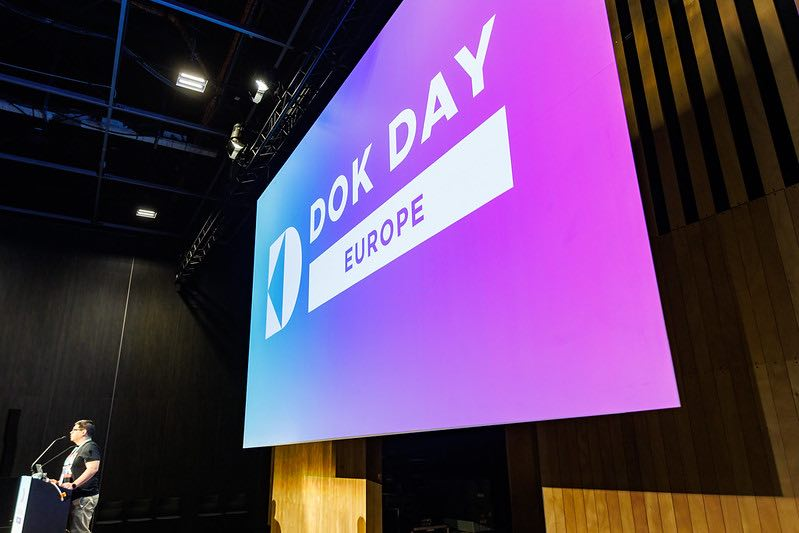
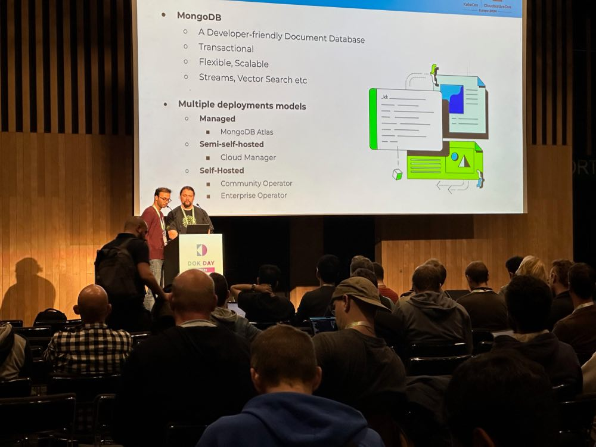

For the second time, the Data on Kubernetes Community’s DoK Day event was hosted by the CNCF as a co-located event at KubeCon Europe 2024 in Paris, France – and it was our biggest and most well attended event yet!

The city of lights was the cloud native hub for four days, hosting over 12,000 people from across the world. I was one of those people that made the journey from North America, traveling 16 hours to make my way from Sacramento to Paris.

DoK Day and KubeCon took place at the expansive Paris Expo Porte de Versailles at the far southern edges of the 15th arrondissement. I arrived early in the morning along with a sea of cloud native enthusiasts all eager to learn and see the latest and greatest in the CNCF landscape. Due to increasing interest in AI and other data workloads on Kubernetes, this was the most highly anticipated DoK Day yet, leading to our mostly highly attended in-person DoK Day with 430+ attendees.

About 15 minutes before DoK Day officially started, people started filtering into the room and some familiar faces appeared. I was finally able to meet many community members in person who I had previously only interacted with via Slack or Zoom. In attendance were five DoK Ambassadors who came to either give a talk or support the community. I was given the honor of giving the opening remarks to officially kick off DoK Day.

The event started off with a talk from Yihong Wang and Ted Chang from IBM. They would be the first but not the last to discuss the topic of the week: AI/ML. Next up, Gabriele Bartolini filled the room with 435 attendants for his talk “[Scaling Postgres in Kubernetes Using the Power of CloudNativePG](https://www.youtube.com/watch?v=jeEBzLmRzwY&list=PLj6h78yzYM2OjPaFr5A1riHxkN66mlKGQ&index=3)”. Following Gabriele, we saw three lightning talks featuring Bernei Wu, DoK Ambassador Robert Hodges and CNCF Ambassador Andrea Giardini.  Throughout the day, people filtered in and out of the room but maintained a consistent number of attendees as the day went on.

After a short break, the day continued with exciting talks from Rajdeep Das and Sebastian Laskawiec, Lu Qiu, Sebastian Beyvers covering topics such as creating database operator from scratch, advanced CSI-FUSE filesystem for AI/ML data management and Cloud-Native Dataspaces. The day ended with an amazing talk from community member and Strimzi maintainer Jakub Sholz titled “Released From the Cage: Apache Kafka Without Its Zookeeper.”

In addition to DoK Day, the DoK community was featured in talks throughout the week. On Thursday, DoK Ambassador Gabriele Bartolini, along with Gari Singh of Google, presented their talk “[Scaling Heights: Mastering Postgres Database Vertical Scalability with Kubernetes Storage Magic](https://youtu.be/LArl0VWxr3Y).” Before going on the stage, Gabriele shook each one of his colleagues’ hands and said “This is for all of us,” giving a nod to each of their contributions to get him to this point.

To end an amazing week at KubeCon, the Data on Kubernetes community presented a panel discussion to a packed keynote room with panelists DoK Ambassador Robert Hodges of Altinity, Clayton Coleman of Google, Piotr Szczepaniak of Percona and moderated by DoK Ambassador, Edith Puclla. The topic of the panel was Kubernetes as a Data Platform. The panelists discussed what is and isn’t working in the current landscape of running stateful workloads and agreed that a maturing ecosystem of operators was making running data workloads much more simple. Additionally, that the growing community of practitioners in DoKC who are sharing knowledge is making running data workloads more attainable.

<iframe src="https://www.youtube-nocookie.com/embed/rphD1vCarNQ" title="YouTube video" loading="lazy" allow="accelerometer; clipboard-write; encrypted-media; gyroscope; picture-in-picture" allowfullscreen></iframe>

## Key takeaways from the week

1. AI/ML was the [topic of the week](https://www.youtube.com/watch?v=cg5mlcEu0bk&t=15m51s) and is driving the growth of DoK. Over half of the talks on DoK Day broached the subject.
2. People care deeply about what they are doing. Each of our DoK Day speakers as well as those that gave DoK related talks at KubeCon, all showed a level of expertise and passion and eagerly shared it with the community.
3. The community is strong and growing. We saw over 430+ people at peak attendance during DoK Day, the most we’ve ever seen – and the show floor was abuzz with conversations about how to deploy and manage data workloads from databases to streaming to AI and ML

## DoK Day Replay

If you weren't able to attend DoK Day in person, you can watch all of the talks on the CNCF YouTube channel [here](https://www.youtube.com/playlist?list=PLj6h78yzYM2OjPaFr5A1riHxkN66mlKGQ).
