As 2021 is coming to an end, we wanted to take a step back to appreciate what the Data on Kubernetes Community achieved. Spoiler alert: a lot!

The DoKC organized not one Dok Day, but two! For KubeCon EU and KubeCon NA, we learned a ton from our community. If you were not able to attend, fear not! You can access all the talks [here](/dokday-europe-2021/) (EU) and [here](/blog/category/dok-day-kubecon-na-2021/) (NA).  Our Dok Days include music interludes, an excellent way to relax in between talks!

We may be called pioneers, but the truth is that DoK is a already thing. Thanks to our first [Data on Kubernetes industry report](/dokc-2021-report/) – that surveyed 500 practitioners coming from different organizations sizes and types – we learned that 90% of respondents believe that Kubernetes is ready to run stateful workloads in production. Even more impressive, 70% are already doing so!

<iframe src="https://www.youtube-nocookie.com/embed/ZW-Nhkc1-uM" title="YouTube video" loading="lazy" allow="accelerometer; clipboard-write; encrypted-media; gyroscope; picture-in-picture" allowfullscreen></iframe>

Do you know what the letter “C” stands for in DoKC? You guessed it right, it stands for community, and all we can say is that the DoK one is amazing! Now over 2,000 members strong, they contributed with [86 live streams](https://www.youtube.com/c/DoKcommunity/videos) sharing their knowledge and insights on how running stateful workloads on Kubernetes can make the world a better place.

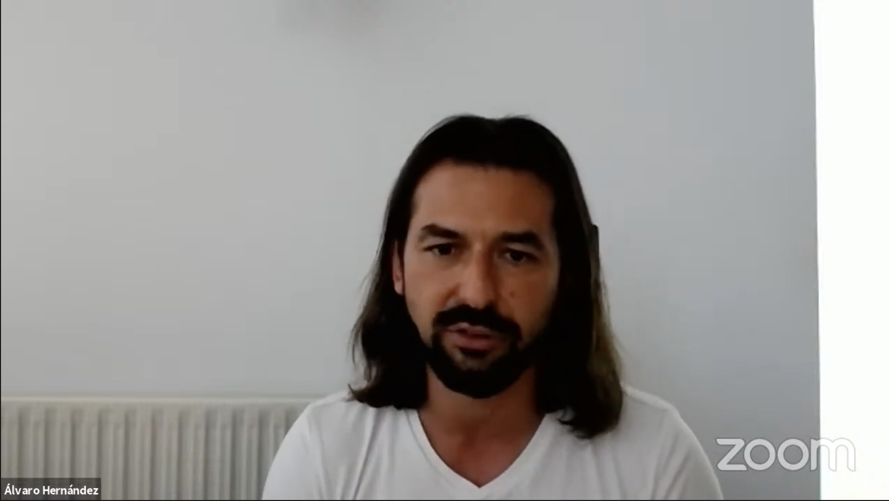

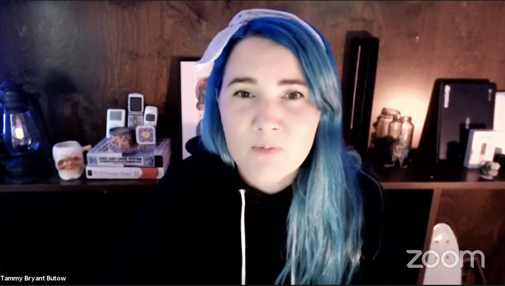

The community also participated by writing op-eds and blog posts such as Álvaro Hernández with his [Kubernetes Will Revolutionize Enterprise Database Management](https://thenewstack.io/kubernetes-will-revolutionize-enterprise-database-management/) op-ed or Rick Vasquez's discussion on why [Kubernetes Needs Deep System Integrations](https://thenewstack.io/kubernetes-needs-deep-system-integrations/).

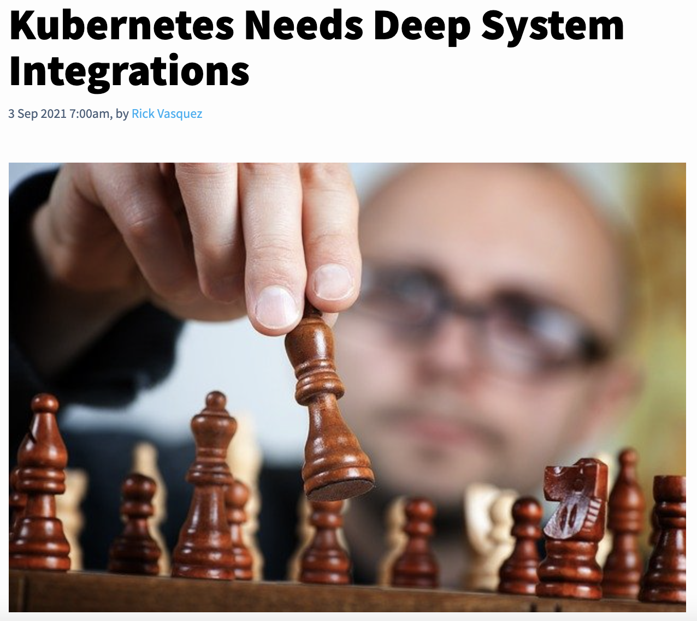

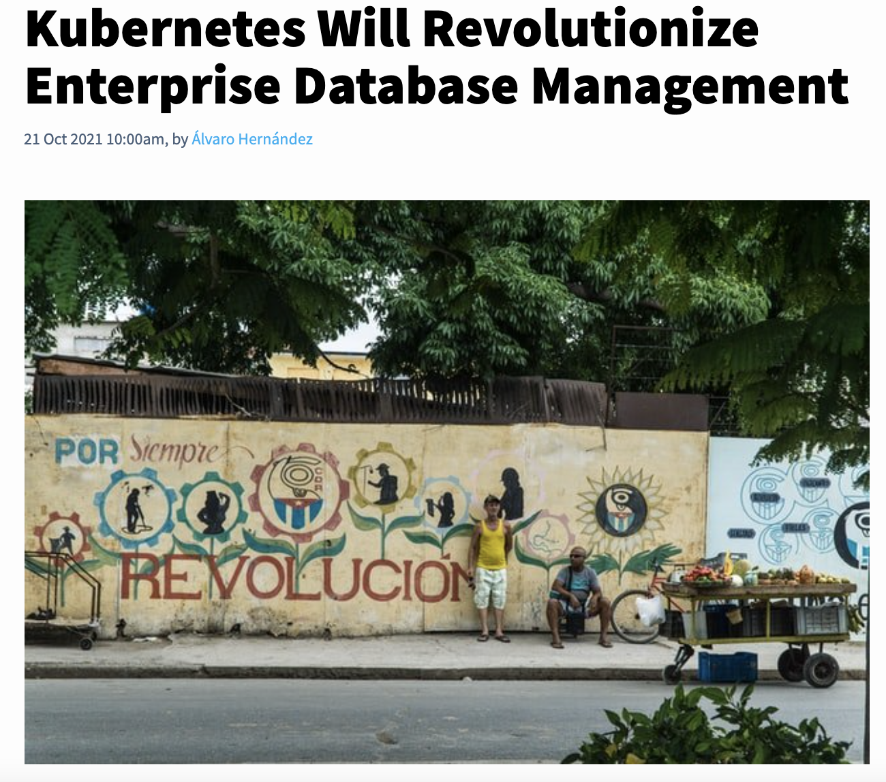

We believe that the future of technology is in good hands which is why we support our amazing student group! DoKC would not be the same without them. They gave 31 talks on [DoK Students Day](https://www.youtube.com/watch?v=W04d8-P5dCQ&list=PLHgdNuGxrJt0Tr28IbaGI7aYAEASIAiwz), and the [Transcript Team](https://twitter.com/birthmarkbart/status/1468952986671980553) is the reason why you can read the transcripts of the talks from the comfort of your sofa!

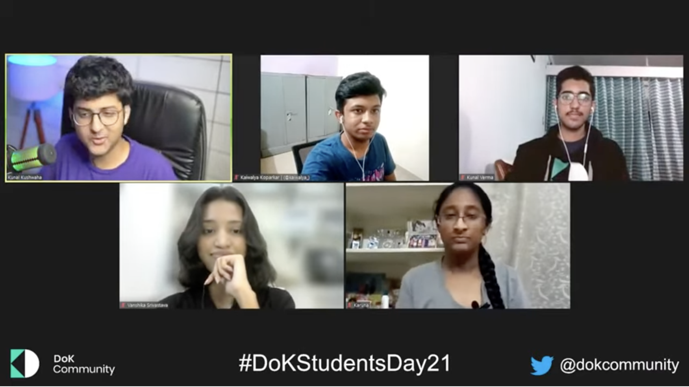

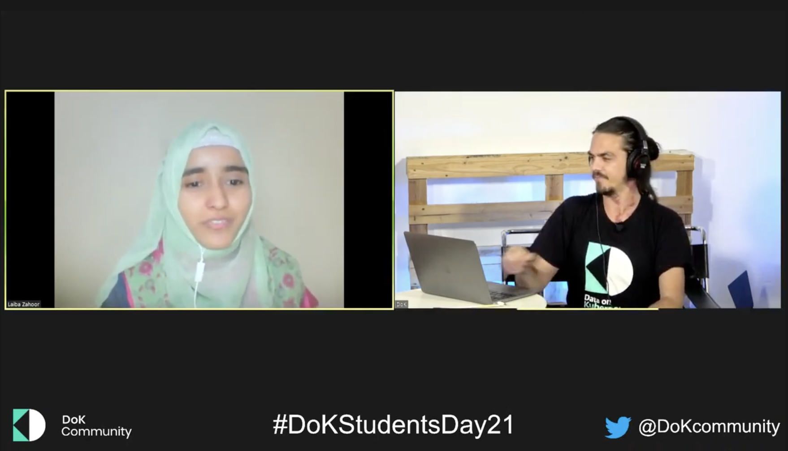

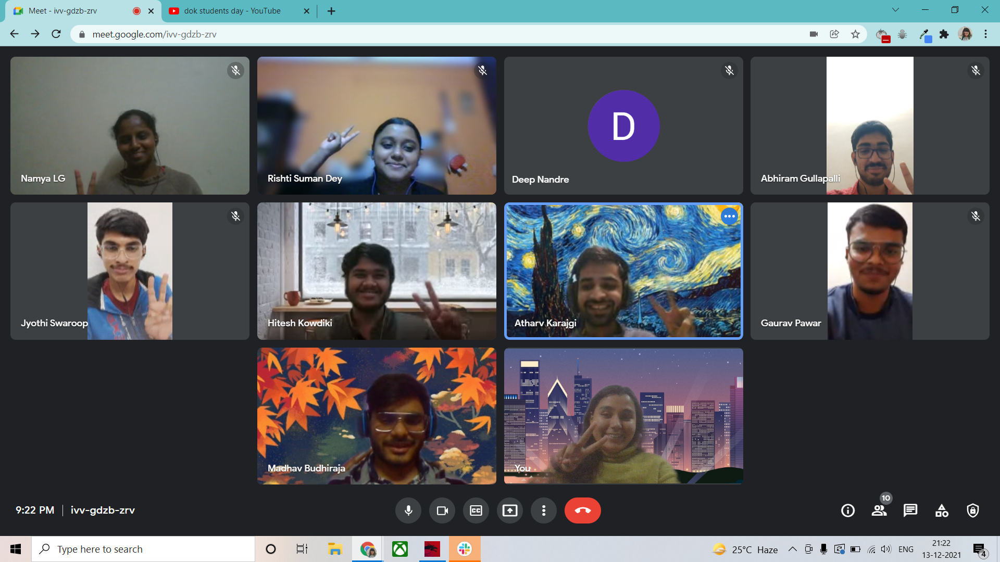

Let's be honest, DoK is as fun as the people you do it with. If you know anyone who knows how to make learning data on Kubernetes more fun than our dear Bart does, get them in our Slack and have them challenge him to a rap battle ASAP!

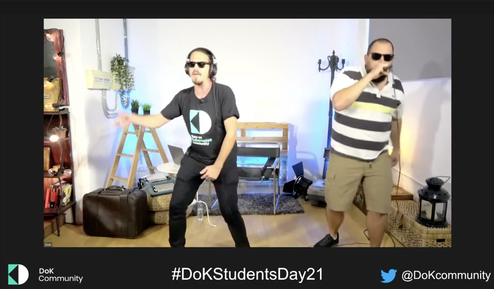

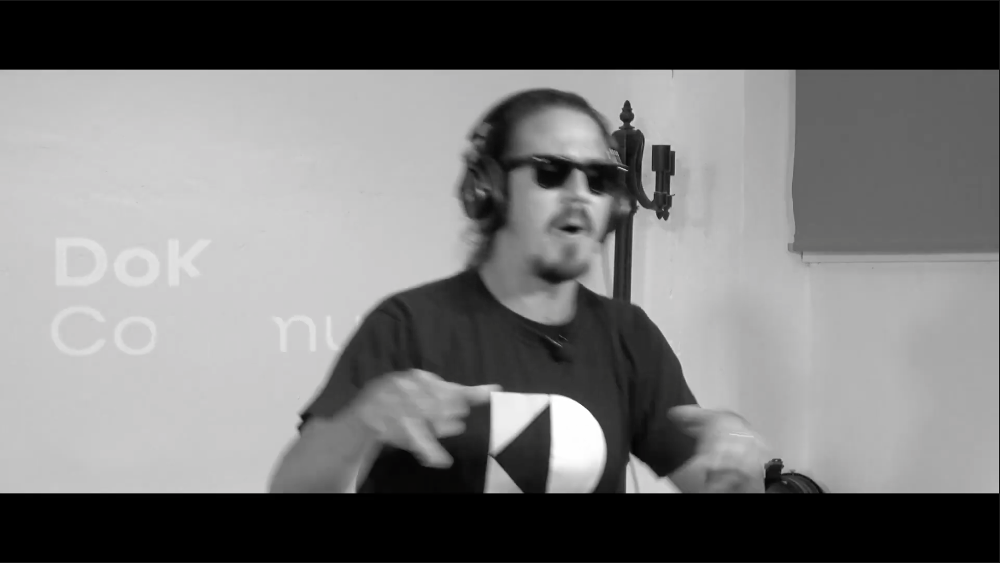

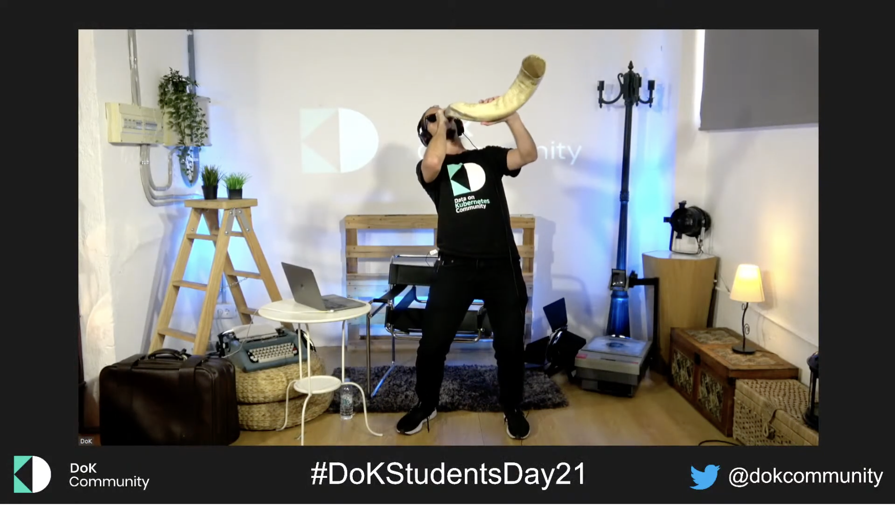

The staff making sure that the community is humming has quadrupled. [Bart](https://www.linkedin.com/in/bart-farrell/) was joined by DoKC Director [Melissa Logan](https://www.linkedin.com/in/mklogan/), Marketing Operations [Diogenese Topper](https://www.linkedin.com/in/diogenese-topper-ab8a67227/), and Head of Content [Sylvain Kalache](https://www.sylvainkalache.com/).

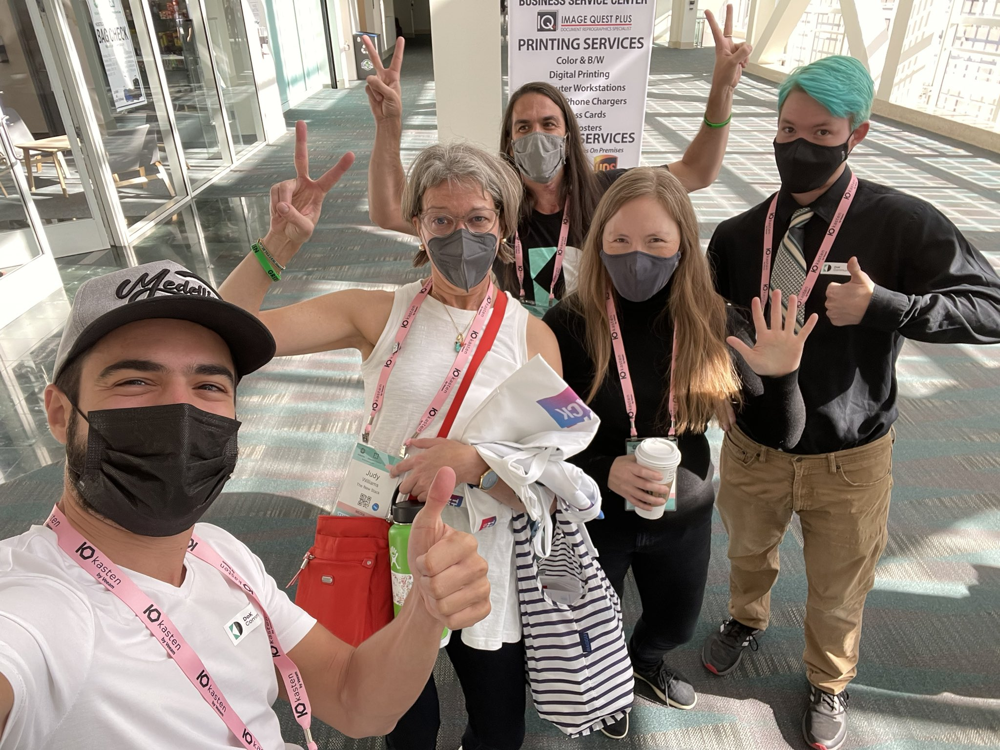

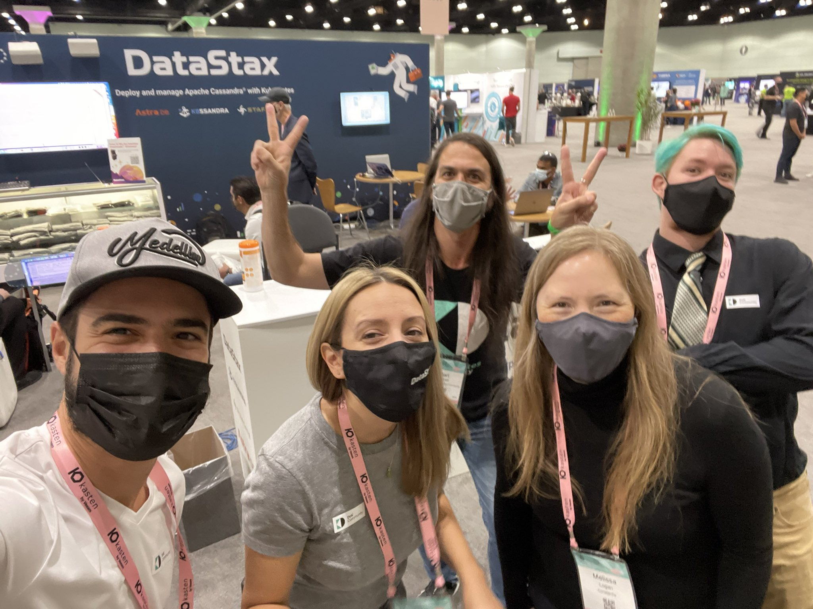

Finally, the community also welcomed a new governance structure – [with over 20 sponsors joining](/sponsors/) – to accelerate the emergence and development of techniques for the use of Kubernetes for data. DoKC is made possible thanks to DataStax, EDB, MayaData, and Portworx by Pure Storage. Also in thanks to our Gold sponsors Percona and Red Hat, and the Silver sponsors Airbyte, Altinity, anynines, Civo, Cockroach Labs, DigitalOcean, Fullstaq, ionir, Kasten by Veeam, KubeSphere, observIQ, Okteto, OnGres, portainer.io, Red Kubes, Stark & Wayne, StorageOS, TerminusDB and, TimeScale.

With all of this, we wish you happy holidays and a happy new year!

## Platinum

---

## Gold

---

## Silver

