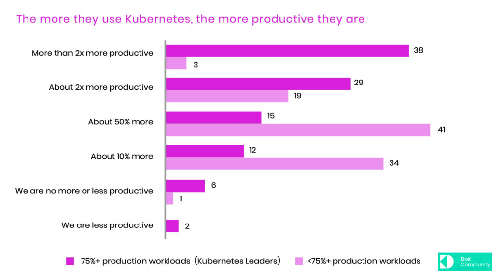

Regardless of which survey you read, the use of Kubernetes is on the rise in organizations of all sizes. While Kubernetes was initially designed for stateless workloads, the community has made major strides in supporting stateful workloads. Today, we are excited to announce DoKC first [research report about the state of data on Kubernetes](/dokc-2021-report/)!

We engaged a research firm to survey over 500 Kubernetes users to understand the types and volume of data workloads being deployed in Kubernetes, benefits and challenges, and factors driving further adoption.

What we found is that Kubernetes has become a core part of IT – half of the respondents are running 50% or more of their production workloads on it, and they’re very satisfied and more productive as a result. The most advanced users report 2x or greater productivity gains.

While Kubernetes has a strong stateless-centric past, 90% of organizations believe it’s now ready for stateful workloads and a large majority (70%) are running them in production with databases topping the list. Companies report significant benefits to standardization, consistency, and management as key drivers.

However, significant challenges remain. As they seek to expand their data on Kubernetes footprint, enterprises find a lack of integration and interoperability with existing tools and stacks; skilled staff; quality of Kubernetes operators; and trusted vendors.

The report shows that business demands are creating pressures for further adoption. The increasing importance of real-time data to competitive advantage will sharpen companiesʼ need to run data on Kubernetes. A majority believe standards will improve data management and that data should become declarative.

The full report is available [here](/dokc-2021-report/).
