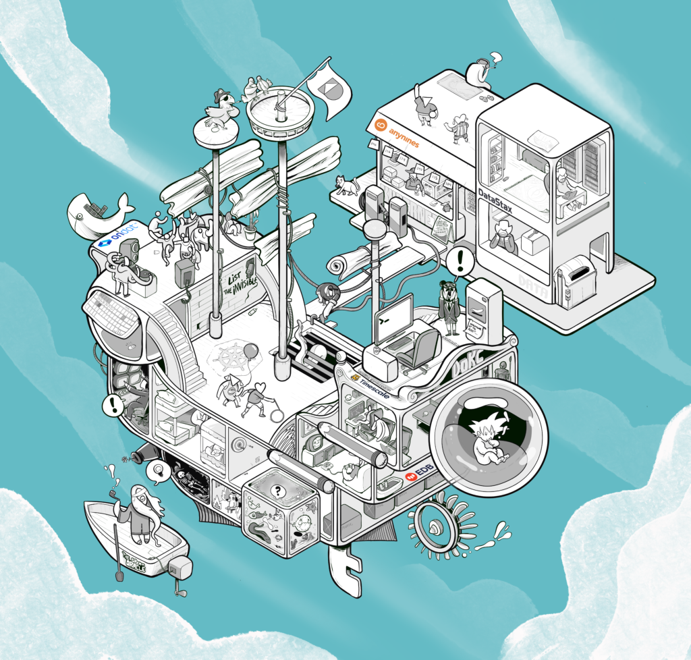
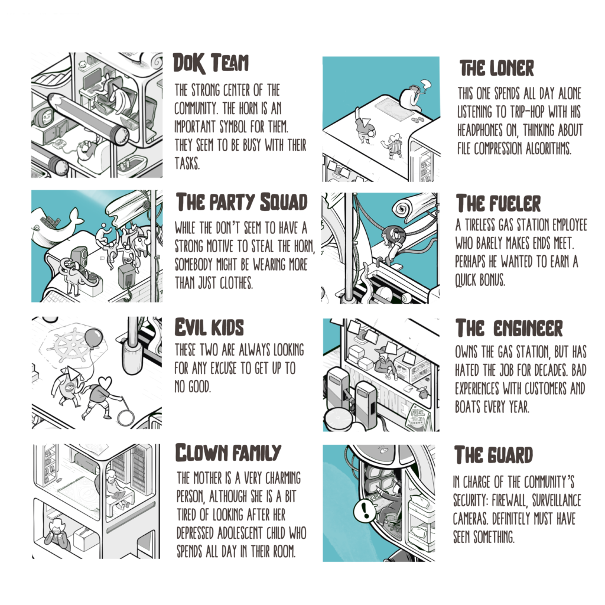
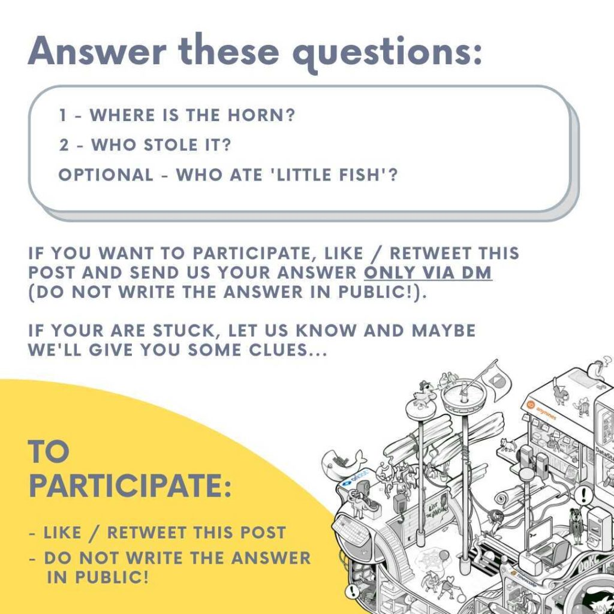

As Bart was preparing to record videos for [DoK Day @ KubeCon EU 2022](/blog/dok-day-kubecon-eu-2022-schedule-is-here/) –where you can learn all about running stateful workloads on Kubernetes – he realized that the community horn was missing. 😱

<iframe src="https://www.youtube-nocookie.com/embed/VmmVzOyB6UQ" title="YouTube video" loading="lazy" allow="accelerometer; clipboard-write; encrypted-media; gyroscope; picture-in-picture" allowfullscreen></iframe>

He frantically ran around town to attempt to find it – but no luck. As he was nearing exhaustion, he received a mysterious call from someone who knows where the horn is: the Oracle! 🧙

<iframe src="https://www.youtube-nocookie.com/embed/4FkqVm8X6SI" title="YouTube video" loading="lazy" allow="accelerometer; clipboard-write; encrypted-media; gyroscope; picture-in-picture" allowfullscreen></iframe>

According to the Oracle, the horn is hidden somewhere in the DoK boat, and only with the power of the Twitter DoK community could the horn be found.

Everybody in this world is a fan of running data on Kubernetes, but they also play other roles, let’s meet a few of them.

The main quest is to find the hidden horn, but there are a few other questions that could be answered.

To enroll in the quest, liking and retweeting this post is your duty!

Clues can be found around the boat. For additional help, Bash commands can be entered into the boat computer by sending them to us via Twitter DMs at <https://twitter.com/DoKcommunity>.

More instructions and clues will be posted on the Twitter thread, stay tuned!

A big shoutout to our DoK Day @ Kubecon EU 2022 sponsors [anynines](https://www.anynines.com/), [DataStax](https://www.datastax.com/), [EDB](https://www.enterprisedb.com/), [Ondat](https://www.ondat.io/), and [Timescale](https://www.timescale.com/) Join us on May 16th by [registering here](/blog/dok-day-kubecon-eu-2022-schedule-is-here/)!
