In the following tutorial, we will explore and learn the foundations of building an event-driven app based on a cloud-native approach. We will develop several cloud-native microservices, deploy them over a minikube cluster, and install [Memphis](https://github.com/memphisdev/memphis-broker), which is a cloud-native real-time data processing platform that will enable communication between the services. Finally, we will run the entire application on a Kubernetes cluster.

The chosen use case is a food-delivery application like Doordash.

## The technology stack we will use

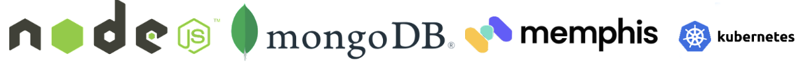

- [Node.js](https://nodejs.org/en/) as our primary dev-lang
- [MongoDB](https://www.mongodb.com/cloud/atlas/lp/try4?utm_source=google&utm_campaign=gs_emea_israel_search_core_brand_atlas_desktop&utm_term=mongodb&utm_medium=cpc_paid_search&utm_ad=e&utm_ad_campaign_id=12212624530&adgroup=115749707943&gclid=Cj0KCQjw6_CYBhDjARIsABnuSzpM5YbZ-c8mKM1wnZ_TyBJ263zgReMiVuhdHjL7PRJPWk2cShVHaiEaArfJEALw_wcB) for order persistency
- [Memphis](https://memphis.dev/) is a message broker for developers
- [Kubernetes](https://kubernetes.io/) will host our microservices

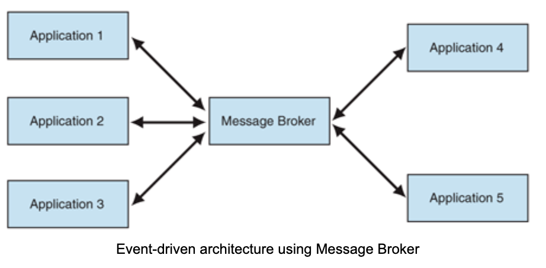

## High-Level Plan

1. Install Minikube using the brew package manager.
2. Install [Memphis](https://github.com/memphisdev/memphis-broker) over Minikube.
3. Clone “[the Door-Dash-like-app](https://github.com/yanivbh1/FastMart)” GitHub repo. We will call it Fastmart
4. Review the code, the different services, and how they interact with each other.
5. Deploy “Fastmart” over Kubernetes.
6. Order food!

## Let’s start!

1.**Install Minikube**

Installation commands of Minikube are available here

<https://minikube.sigs.k8s.io/docs/start/>. Minikube is a local Kubernetes, making it easy to learn and develop Kubernetes-native apps.

Once the Docker engine and minikube are installed, run the following command:

**1. minikube start**

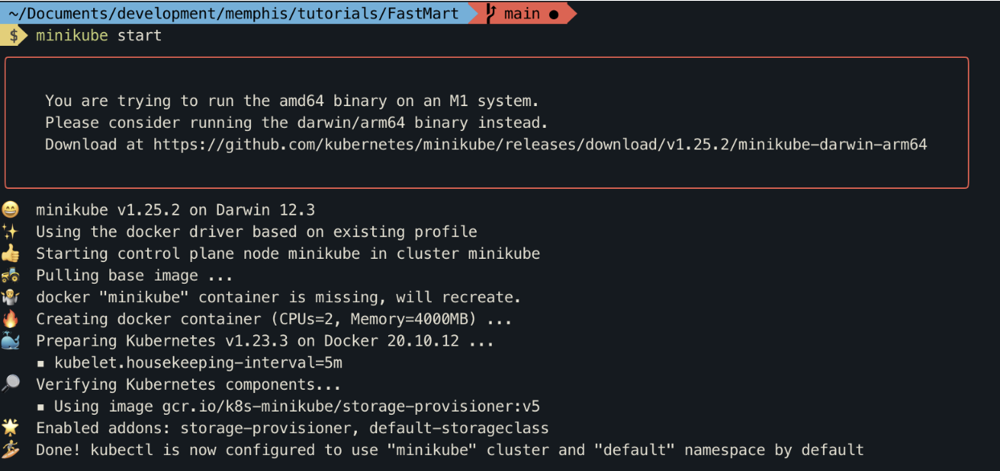

Verify that minikube has started correctly by running the following command:

A healthy output should look as follow

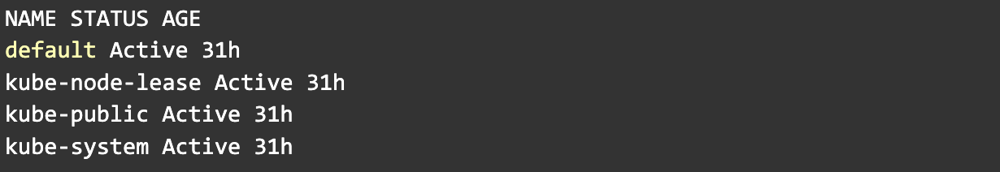

2.**Install Memphis** by running the following command in your terminal

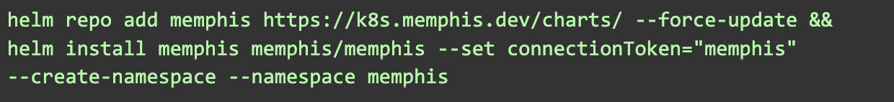

Once Memphis Helm notes have appeared, it means you have a healthy, running Memphis cluster.

3.**Clone** the tutorial repo
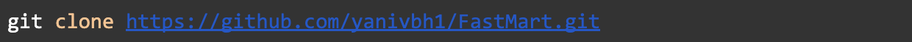

### System Architecture, Code, and Flow

# **How to build a cloud-native event-driven app and deploy to Kubernetes**

### 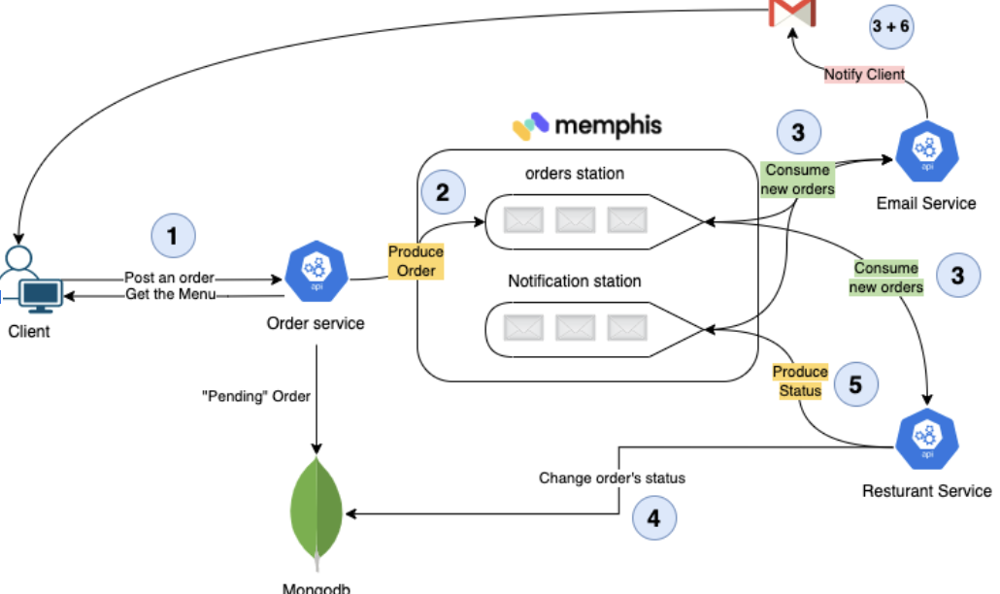

### Architecture

Follow the numbers to understand the flow.

Our app has three main components: order, email, restaurant.

1. **Order service.**

Exposes REST endpoints that allow clients to fetch the food menu, place an order and track the order in real-time.

A new order will be saved in MongoDB with the status “Pending” and will be produced (Pushed) into the “orders” station

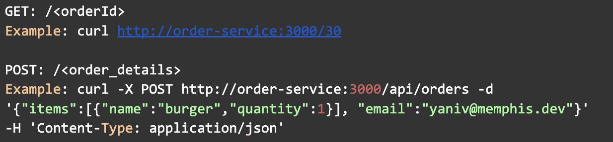

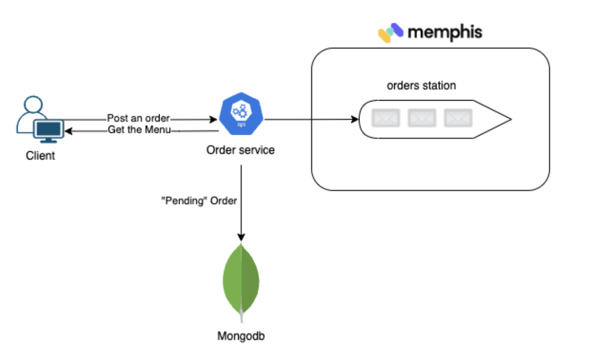

The code responsible for communicating with Memphis will be found on every service at the same path.

- When initializing the app/service for the first time, a memphisConnect object needs to be created. Producer/Consumer entity as well.
- Username and ConnectionToken can be generated using Memphis UI or CLI.
- To produce or push data/events/messages to Memphis station, we use **producer.produce**

- To consume or pull data/events/messages from Memphis station, we use  **consumer.consume**

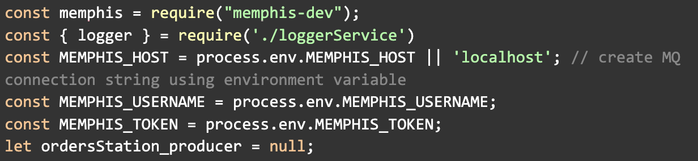

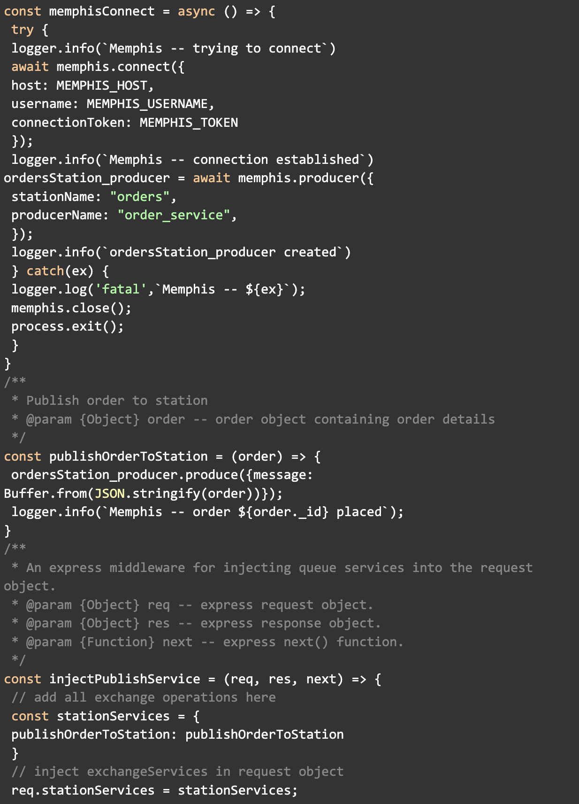

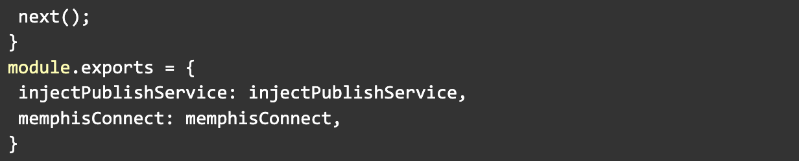

2. **Email service**

The email service is responsible for notifying the customer about the different stages of the order.

The email-service consumer receives messages from two stations: orders and notifications.

As soon as an order is inserted into the station, the email service notifies the client with an order confirmation and, listens for new notification requests from other services.

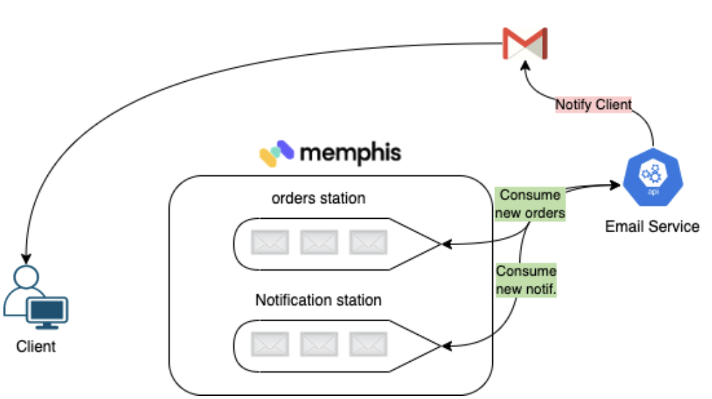

3. **Restaurant service.**

The restaurant service is responsible for fulfilling orders.

1. Consume orders
2. Process orders
3. Change orders status at the MongoDB level to “Accepted”
4. Using constant sleep time to mimic the preparation of the food by the restaurant
5. Change orders status at the MongoDB level to “Delivered”
6. Sending notification to the customer

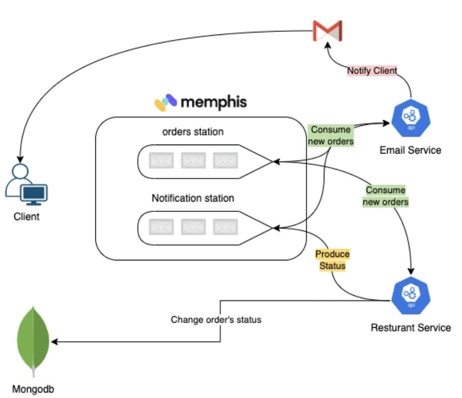

5. **Deploy the app over Kubernetes**

While in the root folder,  **run** **kubectl apply -f k8s-deployment.yaml**
This command will apply a manifest, telling Kubernetes how to deploy, run, and manage our application within Kubernetes. Once apply finished successfully, run the following command and check the output.

You should receive an output as follow.

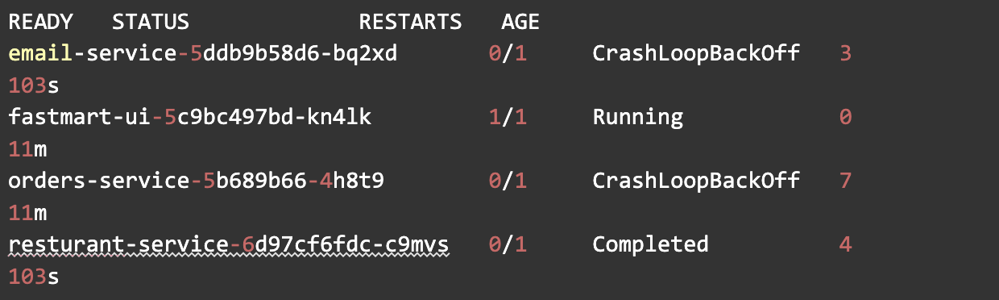

As we can see, not all pods started.

Let’s understand why. Please replace email-service-x with the name of the email-service pod you have in your station.

We should see a similar output.

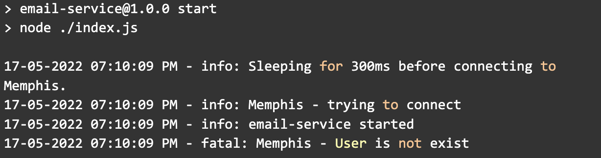

It appears that the services try to connect to “Memphis” with the user “fastmart” which does not exist and we are required to create it.

The simplest way to add a new user would be through the UI, but let’s do it via CLI.

Install Memphis CLI, you can follow the tutorial [here](https://docs.memphis.dev/memphis-new/cli/installation).

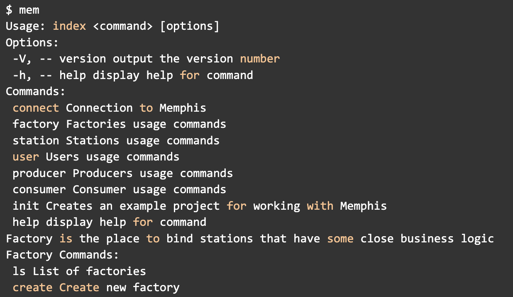

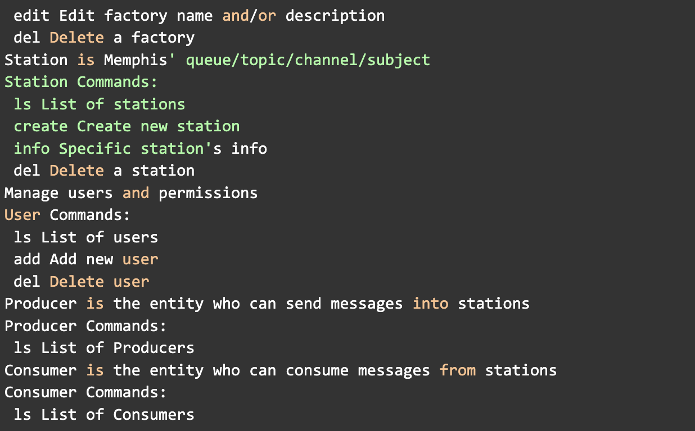

To target the CLI to our local memphis cluster, we need to:

**1)Generate a root password**

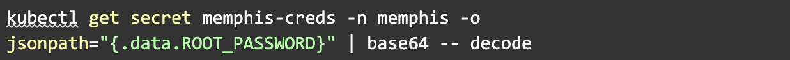

**2)memphis UI URL** 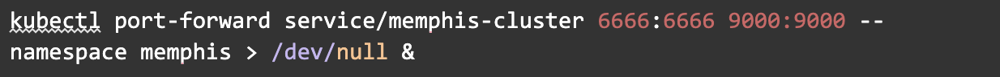

**3) Connect the CLI with Memphis**

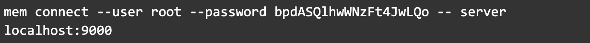

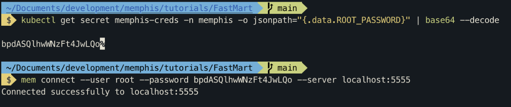

4) Add the user “fastmart”

\*\*Soon after we will create the user,

the pods will restart automatically and reconnect with Memphis.\*\*

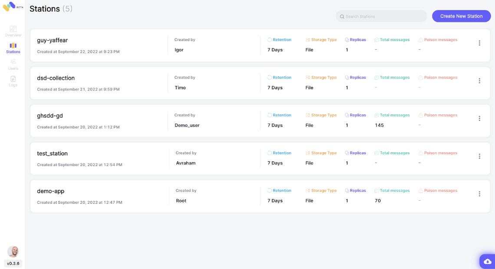

Station overview

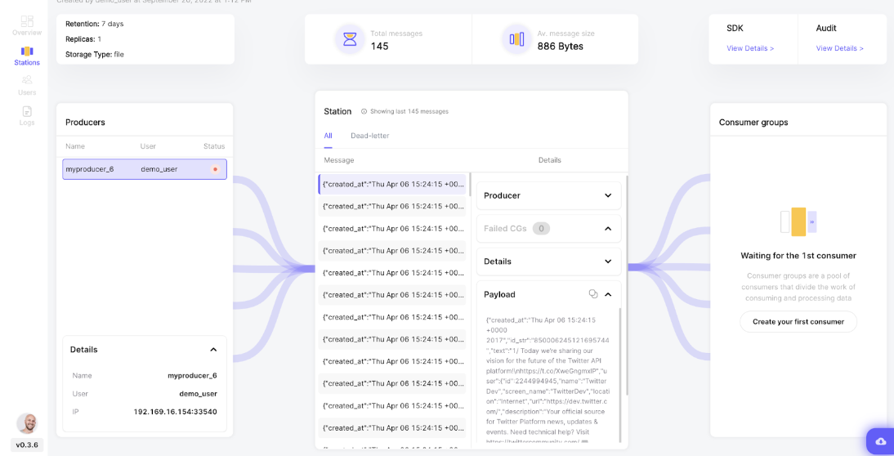

**6)Order food!**

To expose the orders-service through localhost, run the following command.

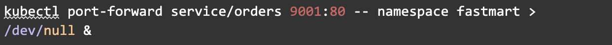

Get the menu.

Output.

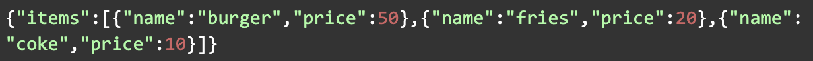

Run this command to pass an order.

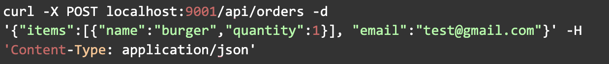

An email should arrive shortly at the email address specified above.
