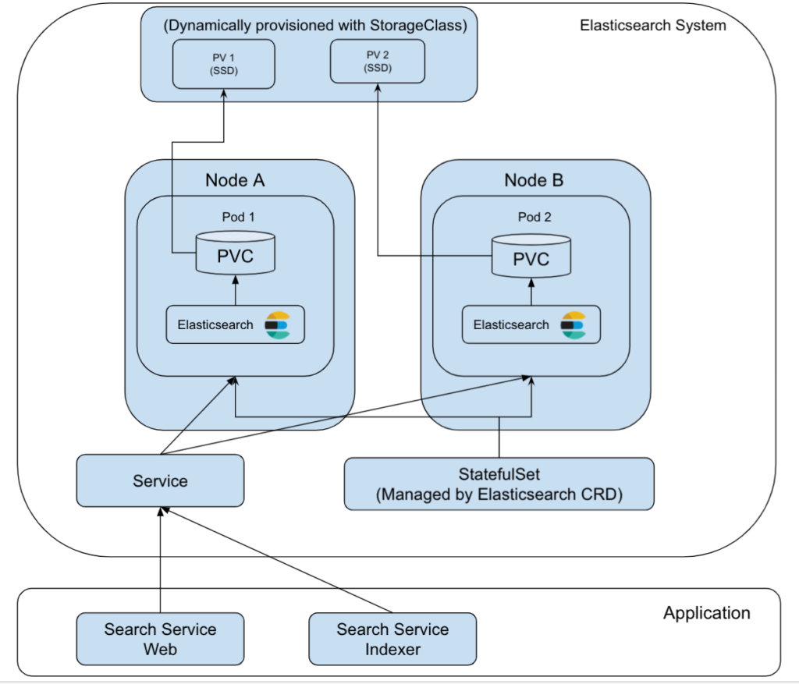
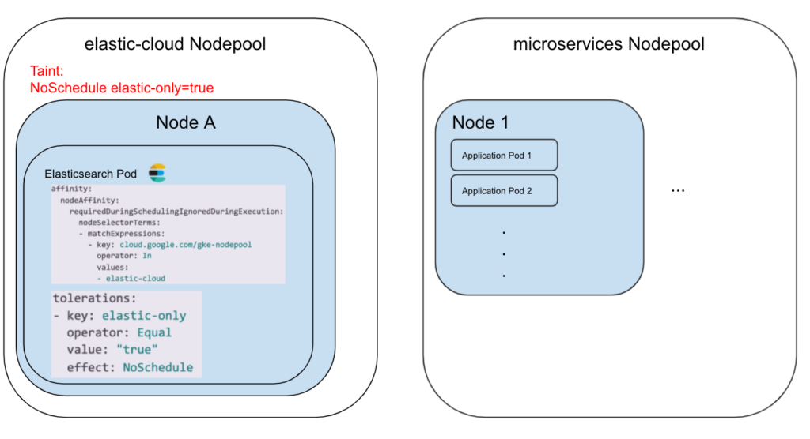

99.co is Singapore’s fastest-growing real estate portal. We power our [listings search](https://www.99.co/singapore/sale) feature with Elasticsearch (ES), a distributed search engine that can perform complicated search queries at a fast speed. Our backend is a microservices architecture running in Google Kubernetes Engine (GKE), which includes the search service.

Our search service was running on GKE, but our ES cluster was not. As seen in the diagram below, we used to run our ES cluster on Docker containers in GCP VM instances. This article will detail how we migrated our ES infrastructure to be fully hosted on a Kubernetes cluster.

While it is acceptable to run an ES cluster self-managed servers, problems might come when a maintenance is needed. Examples include: scaling up the machine’s resources (CPU/memory), performing software upgrades, or adding new ES nodes. We had to do [rolling upgrade](https://www.elastic.co/guide/en/elasticsearch/reference/current/rolling-upgrades.html) by spinning down each ES node and server, performing the maintenance, and starting up each machine and container one by one. While it is simple in theory, in practice, things could go south pretty quickly.

Early this July, we experienced a 6 hours outage on one of our three shards while upgrading our ES cluster. A network connection misconfiguration in istio-proxy stopped the rebalancing process and ultimately degraded our service performance below our 99.9% SLA. Although we managed to restore it before business hours, night outages are not something we ever want to go through again. Hence, our search for automation began!

# Motivation

[Elastic Cloud on Kubernetes (ECK)](https://www.elastic.co/guide/en/cloud-on-k8s/1.6/index.html) is what we needed. Released to the general public on 16th January 2020, Elasticsearch is now fully compatible with Kubernetes. ECK utilizes a Kubernetes [operator](https://kubernetes.io/docs/concepts/extend-kubernetes/operator/) and [Custom Resource Definition (CRD)](https://kubernetes.io/docs/concepts/extend-kubernetes/api-extension/custom-resources/) to provide a high-level abstraction to deploy, package, and manage ES. ECK offers automated deployment to help reduce the risk of human error during the upgrade or maintenance cycle – which would have prevented our night outage.

ECK also offers many other advantages such as:

- Managing and monitoring multiple ES clusters
- Upgrading to versions with ease
- Scaling cluster capacity up and down
- Changing cluster configuration
- Dynamically scaling local storage (including Elastic Local Volume)
- Scheduling and performing backups

# Our Elastic Cloud on Kubernetes setup

Below is a diagram of the Elastic Cloud on the Kubernetes cluster we built. Let’s go through each part individually.



## Search Service Architecture with ECK

ECK’s Kubernetes CRD and operator have made the setup simple. We only need to add our configuration intoYAML files. Follow along for a step-by-step explanation.

- To start, we need to add ES’s CRD and operator to our Kubernetes cluster.

```
kubectl apply -f https://download.elastic.co/downloads/eck/1.6.0/all-in-one.yaml
```

- The `all-in-one.yaml` file is multiple YAML files bundled together. Kubernetes will create a namespace called `elastic-system` where the elastic-operator will be running along with other necessary objects.

```
# Source: eck-operator/templates/operator-namespace.yaml

apiVersion: v1

kind: Namespace

metadata:

  name: elastic-system

  labels:

    name: elastic-system

---

# Source: eck-operator/templates/service-account.yaml

apiVersion: v1

kind: ServiceAccount

metadata:

  name: elastic-operator

  namespace: elastic-system

  labels:

    control-plane: elastic-operator

    app.kubernetes.io/version: "1.6.0"

---

# Source: eck-operator/templates/webhook.yaml

apiVersion: v1

kind: Secret

metadata:

  name: elastic-webhook-server-cert

  namespace: elastic-system

  labels:

    control-plane: elastic-operator

    app.kubernetes.io/version: "1.6.0"

---

# Source: eck-operator/templates/configmap.yaml

apiVersion: v1

kind: ConfigMap

metadata:

  name: elastic-operator

  namespace: elastic-system

  labels:

    control-plane: elastic-operator

    app.kubernetes.io/version: "1.6.0"

data:

  eck.yaml: |-

    log-verbosity: 0

    metrics-port: 0

    container-registry: docker.elastic.co

    max-concurrent-reconciles: 3

    ca-cert-validity: 8760h

    ca-cert-rotate-before: 24h

    cert-validity: 8760h

    cert-rotate-before: 24h

    set-default-security-context: true

    kube-client-timeout: 60s

    elasticsearch-client-timeout: 180s

    disable-telemetry: false

    validate-storage-class: true

    enable-webhook: true

    webhook-name: elastic-webhook.k8s.elastic.co
```

- A critical part of the elastic-operator configuration is towards the end of the file, which uses StatefulSet. A pod called `elastic-operator-0` will be running in the `elastic-system` namespace. This operator is responsible for managing and monitoring the ES CRDs, such as scaling the cluster, changing cluster configuration.

```
# Source: eck-operator/templates/statefulset.yaml

apiVersion: apps/v1

kind: StatefulSet

metadata:

  name: elastic-operator

  namespace: elastic-system

  labels:

    control-plane: elastic-operator

    app.kubernetes.io/version: "1.6.0"

spec:

  selector:

    matchLabels:

      control-plane: elastic-operator

  serviceName: elastic-operator

  replicas: 1

  template:

    metadata:

      annotations:

        # Rename the fields "error" to "error.message" and "source" to "event.source"

        # This is to avoid a conflict with the ECS "error" and "source" documents.

        "co.elastic.logs/raw": "[{\"type\":\"container\",\"json.keys_under_root\":true,\"paths\":[\"/var/log/containers/*${data.kubernetes.container.id}.log\"],\"processors\":[{\"convert\":{\"mode\":\"rename\",\"ignore_missing\":true,\"fields\":[{\"from\":\"error\",\"to\":\"_error\"}]}},{\"convert\":{\"mode\":\"rename\",\"ignore_missing\":true,\"fields\":[{\"from\":\"_error\",\"to\":\"error.message\"}]}},{\"convert\":{\"mode\":\"rename\",\"ignore_missing\":true,\"fields\":[{\"from\":\"source\",\"to\":\"_source\"}]}},{\"convert\":{\"mode\":\"rename\",\"ignore_missing\":true,\"fields\":[{\"from\":\"_source\",\"to\":\"event.source\"}]}}]}]"

        "checksum/config": 3c2010a9355a35f49003014b553c3315c92569d20875c18788dd85b73a97c6c7

      labels:

        control-plane: elastic-operator

    spec:

      terminationGracePeriodSeconds: 10

      serviceAccountName: elastic-operator

      securityContext:

        runAsNonRoot: true

      containers:

      - image: "docker.elastic.co/eck/eck-operator:1.6.0"

        imagePullPolicy: IfNotPresent

        name: manager

        args:

        - "manager"

        - "--config=/conf/eck.yaml"

        - "--distribution-channel=all-in-one"

        env:

        - name: OPERATOR_NAMESPACE

          valueFrom:

            fieldRef:

              fieldPath: metadata.namespace

        - name: POD_IP

          valueFrom:

            fieldRef:

              fieldPath: status.podIP

        - name: WEBHOOK_SECRET

          value: elastic-webhook-server-cert

        resources:

          limits:

            cpu: 1

            memory: 512Mi

          requests:

            cpu: 100m

            memory: 150Mi

        ports:

        - containerPort: 9443

          name: https-webhook

          protocol: TCP

        volumeMounts:

        - mountPath: "/conf"

          name: conf

          readOnly: true

        - mountPath: /tmp/k8s-webhook-server/serving-certs

          name: cert

          readOnly: true

      volumes:

      - name: conf

        configMap:

          name: elastic-operator

      - name: cert

        secret:

          defaultMode: 420

          secretName: elastic-webhook-server-cert
```

- Next, we would see multiple CustomResourceDefinitions (CRDs), such as the Elasticsearch CRD below (not everything is pasted here). This CRD defines how to provide the specifications to the Elasticsearch application later on.

```
# Source: eck-operator/charts/eck-operator-crds/templates/all-crds.yaml

apiVersion: apiextensions.k8s.io/v1beta1

kind: CustomResourceDefinition

metadata:

  annotations:

    controller-gen.kubebuilder.io/version: v0.5.0

  creationTimestamp: null

  labels:

    app.kubernetes.io/instance: 'elastic-operator'

    app.kubernetes.io/name: 'eck-operator-crds'

    app.kubernetes.io/version: '1.6.0'

  name: elasticsearches.elasticsearch.k8s.elastic.co

spec:

  additionalPrinterColumns:

  - JSONPath: .status.health

    name: health

    type: string

  - JSONPath: .status.availableNodes

    description: Available nodes

    name: nodes

    type: integer

  - JSONPath: .status.version

    description: Elasticsearch version

    name: version

    type: string

  - JSONPath: .status.phase

    name: phase

    type: string

  - JSONPath: .metadata.creationTimestamp

    name: age

    type: date

  group: elasticsearch.k8s.elastic.co

  names:

    categories:

    - elastic

    kind: Elasticsearch

    listKind: ElasticsearchList

    plural: elasticsearches

    shortNames:

    - es

    singular: elasticsearch

  scope: Namespaced

  subresources:

    status: {}

  validation:

    openAPIV3Schema:

      description: Elasticsearch represents an Elasticsearch resource in a Kubernetes

        cluster.

      properties:

        apiVersion:

          description: 'APIVersion defines the versioned schema of this representation

            of an object. Servers should convert recognized schemas to the latest

            internal value, and may reject unrecognized values. More info: https://git.k8s.io/community/contributors/devel/sig-architecture/api-conventions.md#resources'

          type: string

        kind:

          description: 'Kind is a string value representing the REST resource this

            object represents. Servers may infer this from the endpoint the client

            submits requests to. Cannot be updated. In CamelCase. More info: https://git.k8s.io/community/contributors/devel/sig-architecture/api-conventions.md#types-kinds'

          type: string

        metadata:

          type: object

        spec:

          description: ElasticsearchSpec holds the specification of an Elasticsearch

            cluster.

          properties:

            auth:

              description: Auth contains user authentication and authorization security

                settings for Elasticsearch.

              properties:

                fileRealm:

                  description: FileRealm to propagate to the Elasticsearch cluster.

                  items:

                    description: FileRealmSource references users to create in the

                      Elasticsearch cluster.

                    properties:

                      secretName:

                        description: SecretName is the name of the secret.

                        type: string

                    type: object

                  type: array

.

.

.
```

- Now, we should be able to see the `elastic-operator-0` pod running in the `elastic-system` namespace. We can tail the logs with the command below

```
kubectl -n elastic-system logs -f statefulset.apps/elastic-operator
```

- The next step is to deploy the Elasticsearch cluster itself!
- Before that, we need to create a separate NodePool in our Kubernetes cluster to host the ES nodes. This will help us isolate the ES nodes from our main NodePool, where most of our microservices are running. In case our microservices were running high on CPU/memory, the resources shared to ES might be consumed up and thus affecting the performance of the entire ES cluster. Another benefit is that we can fine-tune the NodePool resource accurately to the ES nodes, especially since they consume a lot of memory.



- To isolate the elastic-cloud NodePool, we use Kubernetes’ scheduling feature [Taint](https://kubernetes.io/docs/concepts/scheduling-eviction/taint-and-toleration/) with the NoSchedule effect. Taint must be added during NodePool creation. We also use the `tolerations` fields so that our Elasticsearch pods can tolerate this taint. The whole policy prevents other pods without tolerance to NoSchedule effect for `elastic-only=true` from scheduling to this NodePool. As a result, only the ES pods can be scheduled in the elastic-cloud NodePool.
- Finally, let’s deploy the ES cluster with its nodes by creating a file called `elasticsearch.yaml`:

```
apiVersion: elasticsearch.k8s.elastic.co/v1

kind: Elasticsearch

metadata:

  name: search-prod

  namespace: sg-prod

spec:

  version: 7.11.1

  nodeSets:

  - name: default

    count: 3

    config:

      node.master: true

      node.data: true

      node.ingest: true

    podTemplate:

      metadata:

        namespace: sg-prod

        labels:

          # additional labels for pods

          env: prod

      spec:

        initContainers:

        - name: sysctl

          securityContext:

            privileged: true

          command: ['sh', '-c', 'sysctl -w vm.max_map_count=262144']

        affinity:

          nodeAffinity:

            requiredDuringSchedulingIgnoredDuringExecution:

              nodeSelectorTerms:

              - matchExpressions:

                - key: cloud.google.com/gke-nodepool

                  operator: In

                  values:

                  - elastic-cloud

        tolerations:

        - key: elastic-only

          operator: Equal

          value: "true"

          effect: NoSchedule

        containers:

        - name: elasticsearch

          resources:

            requests:

              memory: 20G

              cpu: 8

            limits:

              memory: 30G

          env:

    # request xx of persistent data storage for pods in this topology element

    volumeClaimTemplates:

    - metadata:

        name: elasticsearch-data

      spec:

        accessModes:

        - ReadWriteOnce

        resources:

          requests:

            storage: 80Gi

        storageClassName: faster-southeast1-a

    config:

      xpack.security.authc:

        anonymous:

          username: anonymous

          roles: superuser

          authz_exception: false

references

  http:

    tls:

      selfSignedCertificate:

        disabled: true
```

- In Kubernetes nodeSets, we can specify sets of nodes that we want to deploy. For 99.co setup, we are using 1 nodeSets that have 3 nodes, running as the master node, [data node](https://www.elastic.co/guide/en/elasticsearch/reference/current/modules-node.html#data-node), and [ingest node](https://www.elastic.co/guide/en/elasticsearch/reference/current/modules-node.html#node-ingest-node). Internally, the ECK operator will create [StatefulSets](https://kubernetes.io/docs/concepts/workloads/controllers/statefulset/) as each pod (ES Node) needs to be stateful with stable, persistent storage.
- We add initContainers to increase the kernel settings vm.max\_map\_count to 262144 with privileged mode. This increases the virtual address space that can be mapped to files. Without it, we may encounter out-of-memory exceptions. The [documentation](https://www.elastic.co/guide/en/cloud-on-k8s/current/k8s-virtual-memory.html) recommends it for production usage.
- nodeAffinity of requiredDuringSchedulingIgnoredDuringExecution requires the pods to be scheduled only in elastic-cloud NodePool. This, combined with the `tolerations` discussed earlier, will ensure the nodes run only in elastic-cloud NodePool instead of anywhere in the Kubernetes cluster.
- We define the CPU/memory requests and limits, just like how we define resources in Deployments. As for why we need to set the requests & limits, here is an [excellent post on the topic](https://learnk8s.io/allocatable-resources).
- For storage, we ask the operator to request each pod a PersistentVolumeClaim of 80Gb with a specific Storage Class. This allows PersistentVolume to be dynamically provisioned without the need to create PV every time we need it. In this case, storageClass of `faster-southeast1-a` is an [SSD persistent disk type](https://kubernetes.io/docs/concepts/storage/storage-classes/#gce-pd) provided by GCE (Google Compute Engine). Another benefit of using Storage Class is that we can expand the volume automatically in case we are running out of space. In such a scenario, ECK will update the existing PVCs accordingly and recreate the StatefulSets automatically.
- We expose the Service as a LoadBalancer via HTTP. It would otherwise default to a ClusterIP service.
- HTTP over TLS is also enabled by default. Behind the scenes, the elastic-operator will create self-signed certificates. We disabled this as the GCP firewall is protecting our intra-services.
- Now, we run `kubectl apply -f elasticsearch.yaml`, and voila!
- We can see the cluster object (note that `es` is a custom resource definition coming from the `all-in-one.yaml` that we applied at the first step)

```
$ kubectl get es

NAME HEALTH NODES VERSION PHASE AGE

search-prod green 3 7.11.1 Ready 48d
```

- We can also see the ES nodes running as pods

```
```
$ kubectl get pods | grep search-prod-es

search-prod-es-default-0 1/1 Running 0 5h25m

search-prod-es-default-1 1/1 Running 0 5h26m

search-prod-es-default-2 1/1 Running 0 5h28m
```
```

- We can see the StatefulSet and Service created as well. Since we use LoadBalancer as the service, we can call our pods by the external IP directly, in this case 10.148.0.117:9200. If we are only using ClusterIP, we can use `kubectl port-forward service/search-prod-es-http 9200`and hit `localhost:9200`.

```
```
$ kubectl get statefulset | grep search-prod-es

search-prod-es-default 3/3 48d$ kubectl get service | grep search-prod-es

search-prod-es-default ClusterIP None <none> 9200/TCP 48d

search-prod-es-http LoadBalancer 10.31.243.139 10.148.0.117 9200/TCP 48d

search-prod-es-transport ClusterIP None <none> 9300/TCP 48d
```
```

- The elastic-operator also creates a bunch of Secrets for each cluster that we deploy.

```
```
$ kubectl get secret | grep search-prod-es

search-prod-es-default-es-config Opaque 1 48d

search-prod-es-default-es-transport-certs Opaque 7 48d

search-prod-es-elastic-user Opaque 1 48d

search-prod-es-http-ca-internal Opaque 2 48d

search-prod-es-http-certs-internal Opaque 3 48d

search-prod-es-http-certs-public Opaque 2 48d

search-prod-es-internal-users Opaque 2 48d

search-prod-es-remote-ca Opaque 1 48d

search-prod-es-transport-ca-internal Opaque 2 48d

search-prod-es-transport-certs-public Opaque 1 48d

search-prod-es-xpack-file-realm Opaque 3 48d
```
```

- Next step is to deploy Kibana, which is simpler than the Elasticsearch itself. We create a `kibana.yaml`.

```
```
apiVersion: kibana.k8s.elastic.co/v1

kind: Kibana

metadata:

name: search-prod

namespace: sg-prod

spec:

version: 7.11.1

count: 1

elasticsearchRef:

name: search-prod

podTemplate:

metadata:

namespace: sg-prod

labels:

env: prod

spec:

tolerations:

- key: elastic-only

operator: Equal

value: "true"

effect: NoSchedule

containers:

- name: kibana

resources:

requests:

memory: 1Gi

cpu: 500m

limits:

memory: 15Gi

http:

tls:

selfSignedCertificate:

disabled: true
```
```

- Make sure that elasticsearchRef is filled with the ES cluster name from the `metadata.name` field in the `elasticsearch.yaml`. Under the hood, Kibana will create a Deployment instead of StatefulSet, since Kibana doesn’t need any persistent storage.
- Deploy with `kubectl apply -f kibana.yaml`, and we can see the kibana running.

```
$ kubectl get po | grep search-prod-kb

search-prod-kb-df8555ff7-vhp5h 2/2 Running 0 6d13h

$ kubectl get deployment | grep search-prod-kb

search-prod-kb 1/1 1 1 45d

$ kubectl get service | grep search-prod-kb

search-prod-kb-http ClusterIP 10.31.243.93 <none> 5601/TCP 45d
```

# Rolling Upgrade with ECK

At this point, our Elasticsearch cluster is already up and running. Let’s step back to addressing our initial problem, how does ECK manage to perform rolling upgrades to the nodes automatically?

The answer is using [Update Strategy](https://www.elastic.co/guide/en/cloud-on-k8s/current/k8s-update-strategy.html). Since we did not provide the `updateStrategy` in our `elasticsearch.yaml`, it will be defaulted to:

```
```
spec:
 updateStrategy:
   changeBudget:
     maxSurge: -1
     maxUnavailable: 1
```
```

- `maxUnavailable` defaults to `1`, which means this ensures the cluster has no more than 1 unavailable Pod at any point of time.
- `maxSurge` defaults to `-1`, which is unbounded, all Pods can be recreated immediately.

With these settings, when changing the Elasticsearch YAML configuration, the Pod will automatically restart. This also ensures that we only have 1 Pod restarting at a time. Our cluster’s health will be marked as Yellow since we have 1 Pod/ES node down, but it is still enough to serve requests.

Here’s a deeper look into the elastic-operator log after we update the `elasticsearch.yaml` file

```
{“log.level”:”info”,”@timestamp”:”2021–07–15T02:59:38.071Z”,”log.logger”:”driver”,”message”:”Disabling shards allocation”,”service.version”:”1.4.0+4aff0b98",”service.type”:”eck”,”ecs.version”:”1.4.0",”es_name”:”search-prod”,”namespace”:”sg-prod”}
{“log.level”:”info”,”@timestamp”:”2021–07–15T02:59:38.115Z”,”log.logger”:”driver”,”message”:”Requesting a synced flush”,”service.version”:”1.4.0+4aff0b98",”service.type”:”eck”,”ecs.version”:”1.4.0",”es_name”:”search-prod”,”namespace”:”sg-prod”}
{“log.level”:”info”,”@timestamp”:”2021–07–15T02:59:38.491Z”,”log.logger”:”driver”,”message”:”synced flush failed with 409 CONFLICT. Ignoring.”,”service.version”:”1.4.0+4aff0b98",”service.type”:”eck”,”ecs.version”:”1.4.0",”namespace”:”sg-prod”,”es_name”:”search-prod”}
{“log.level”:”info”,”@timestamp”:”2021–07–15T02:59:38.491Z”,”log.logger”:”driver”,”message”:”Deleting pod for rolling upgrade”,”service.version”:”1.4.0+4aff0b98",”service.type”:”eck”,”ecs.version”:”1.4.0",”es_name”:”search-prod”,”namespace”:”sg-prod”,”pod_name”:”search-prod-es-default-0",”pod_uid”:”ed2bce02-dd3d-4c
d9–97ed-af190d69935e”}
```

The operator is disabling shards allocation and requesting for a synced flush, precisely what is recommended by the ES [documentation](https://www.elastic.co/guide/en/elasticsearch/reference/current/rolling-upgrades.html) when performing a manual rolling upgrade. The process is repeated for the rest of the pods. No more human actions are needed to perform a rolling upgrade 🎉!

# Summary

Running Elasticsearch on Kubernetes allows developers/admins to utilize container orchestration by Kubernetes and apply best practices on managing Elasticsearch clusters by the Elastic Operator. While Kubernetes adds A level of complexity, it has the benefit of removing manual operations and offers peace of mind to the engineering team.

References/Inspirations:

- <https://www.elastic.co/blog/introducing-elastic-cloud-on-kubernetes-the-elasticsearch-operator-and-beyond>
- <https://devopscon.io/blog/native-elasticsearch-on-kubernetes-simple-with-eck/>

*This guest post was originally published on*[*99.co's Medium blog*](https://medium.com/99dotco/a-detail-guide-to-deploying-elasticsearch-on-elastic-cloud-on-kubernetes-eck-31808ac60466)*by*Gregorius Marco*.*
