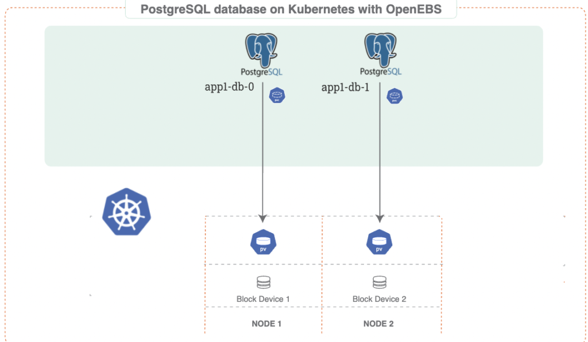

An Object-Relational Database (ORD) combines both entity-relationship modeling, and object-oriented mapping techniques to enable the efficient organization of data from a limited set of data types. As a result, this database model is often referred to as an intermediate solution between object-oriented and relational databases. Using Object-Relational Database Management Systems (ORDBMS), organizations can implement inheritance, enable complex data types that enable useful data manipulation, and extend existing data models.

[PostgreSQL](https://www.postgresql.org/) is one free, open-source ORDBMS that is popularly used to manage the primary back-end databases of dynamic websites, web applications, and geospatial databases. [OpenEBS LocalPV](https://docs.openebs.io/docs/next/localpv.html?__hstc=216392137.e97ef7d6bcd49692cec62e7175c34e58.1624035414231.1629817153943.1629827736182.8&__hssc=216392137.1.1629827736182&__hsfp=3776691191) devices offer the perfect solution to orchestrate Kubernetes storage for PostgreSQL databases, which often deal with heavy loads. [OpenEBS](https://openebs.io/?__hstc=216392137.e97ef7d6bcd49692cec62e7175c34e58.1624035414231.1629817153943.1629827736182.8&__hssc=216392137.1.1629827736182&__hsfp=3776691191) includes a number of storage engines that can be chosen according to the storage available on physical devices and application needs. This post demonstrates how to deploy PostgreSQL Kubernetes operators using OpenEBS LocalPV devices.

# Understanding PostgreSQL

PostgreSQL is a highly stable and advanced open-source database platform that supports both relational and non-relational queries. The database management system comes with comprehensive sets of extensions and rich features such as multi-version concurrency control, granular access control, and tablespaces that make it popular with most web, analytics, geospatial and mobile applications. With over twenty years of open-source support, the platform has grown to support advanced data types, making it a preferred solution for federated hub databases, general-purpose databases, and geospatial data stores.

# The Importance of PostgreSQL to Software firms

Along with being free and open-source, PostgreSQL offers plenty of enterprise-class DBMS features that make it resilient, accurate, and efficient. Some popular reasons for organizations to use PostgreSQL include:

## Rich Features and Extensions

The open-source community behind the PostgreSQL project has developed advanced features that enable nested transactions, online/hot backups, query optimization, and data set scalability. These make it easy even for startups and medium enterprises to manage enterprise-scale databases.

## Highly Customizable

The source code of the PostgreSQL project is available under an open-source license. Organizations can use, modify and implement it within their frameworks as they deem fit at no cost. Additionally, the team of open-source contributors is always working to fix issues, and add features that improve the functionality and reliability of newer versions.

## Compliance and Fault Tolerance

PostgreSQL enables write-ahead logging, which allows organizations to protect data integrity through fault tolerance. The open-source community that backs the project also ensures it complies with modern application security and privacy regulations, making the database system highly reliable. The platform supports multiple data types and programming languages, making it a reliable option for hybrid deployments and hot backups.

PostgreSQL is also a low-maintenance DBMS that requires little training to use and enables the storage and processing of geospatial data to enable location-based services.

# PostgreSQL vs MySQL

While MySQL is a purely relational database, PostgreSQL combines the features of both relational and object-oriented databases. This results in a number of critical differences between the two database management systems, including:

1. PostgreSQL is available under an open-source license, while MySQL is available under a GNU general public license and other proprietary arrangements. PostgreSQL is, therefore, managed by a community of enthusiasts and volunteer contributors while MySQL is owned and managed by the Oracle corporation.
2. PostgreSQL relies on synchronous replication to enable high availability while MySQL relies on one-way asynchronous replication.
3. MySQL is written in C and C++ and supports multiple languages including: C, C++, Delphi, Perl, Java, Lua, .NET, Node.js, Python, PHP, Lisp, Go, R, D, and Erlang. On the other hand, PostgreSQL is written in C and supports as many languages as MySQL does. Both can be deployed on Linux servers in both cloud-based and on-premises environments.
4. PostgreSQL enables materialized data views that improve the application’s performance when processing queries, while MySQL does not support materialized views.

# PostgreSQL Use-cases

Some commonly known use-cases for PostgreSQL include:

## A Robust Database for Web Applications

PostgreSQL is used as part of the LAPP (Linux, Apache, PostgreSQL, Python/PHP/Perl) web stack, an open-source platform used to develop, deploy and run large-scale web servers and sites. This stack is considered a powerful alternative to the popular LAMP stack since it is secure, offers dynamic DNS, enables simple backup & restore, simplifies logical volume management, and is easy to maintain.

## General Purpose OLTP Database

PostgreSQL is a completely ACID-compliant database system, making it ideal for Online Transaction Processing (OLTP) workloads. Recent releases of PostgreSQL include advanced transactional performance functionalities such as parallel query processing, columnar storage, and query optimization. These features have additionally led to an increase in its popularity for both online and analytical processing applications.

## Geospatial Database

PostgreSQL integrates with PostGIS, a custom spatial database extender that allows location queries to be run on SQL, meaning it can support applications that utilize geographic objects.

# PostgreSQL for Kubernetes

Kubernetes allows the management of Stateful workloads such as the PostgreSQL database using StatefulSets. This typically involves the manual configuration of YAML files and the provisioning of Storage Classes and Persistent Volumes. Kubernetes enables the use of operators that allows teams can develop extensions using domain-specific knowledge for easier management. Kubernetes supports various PostgreSQL operators including:

- Stolon
- Crunchy
- Zalando
- KubeDB
- StackGres

# The StackGres Cluster

StackGres is a collection of images and software components founded on a standard PostgreSQL database to enable automated backups, connection pooling, centralized logging, high availability, and a web-based interface for complete feature management. This allows teams to provision and deploy a Postgres cluster in one click. The stack includes Prometheus for monitoring, Grafana dashboards, Envoy filters, Fluentbit & Fluentd for logging. The stack, which can be deployed in one command, enables a fully managed, fully automated PostgreSQL experience for Kubernetes users.

# Kubernetes Deployment Model

When setting up a PostgreSQL cluster in Kubernetes, the PostgreSQL operator defines Custom Resource Definitions (CRDs) to perform database management functions. These CRDs include:

- **pgclusters** - Key node attributes (e.g. CPU/RAM/Disk Size) needed to run PostgreSQL Clusters
- **pgtasks** - allowing the tracking of certain operations and administrative tasks
- **pgreplica** - defines the replicated copies of the PostgreSQL cluster
- **pgpolicies-** files used to record custom policies
- **pgbackups-** tracks the progress and status of backups

# Installing Stackgres PostgreSQL with OpenEBS Storage Engines

OpenEBS storage engines allow software organizations to leverage a [container attached storage (CAS) architecture](https://thenewstack.io/stateful-workloads-on-kubernetes-with-container-attached-storage/) for Kubernetes stateful workloads. The platform converts storage available in Kubernetes machines into Kubernetes Persistent Volumes - that can be used across multiple deployment environments. Key features that make OpenEBS ideal for the persistence of stateful workloads include:

- Container attached storage
- Synchronous replication
- Snapshots & Clones
- Backup & Restore
- Continuous Monitoring & Metrics

OpenEBS implements local and distributed volumes through a collection of data engines that enable replication and high availability. Some benefits of using OpenEBS to provision storage for PostgreSQL databases include:

# OpenEBS is cloud-native and Kubernetes-centric

OpenEBS follows a loosely coupled architecture since the control plane and storage engines are implemented as microservices running in containers. This allows the PostgreSQL database to be run on any Kubernetes platform, and managed using Kubernetes tools and commands.

## Eliminates cloud lock-in

OpenEBS acts as a data abstraction layer, allowing any form of data to be written in the storage engine and moved between different Kubernetes deployment environments.

## Enables team autonomy and granular policies

Microservices-based architecture allows for the formation of loosely coupled teams. This means every team within an organization enjoys autonomy by managing its own storage system, enabling the monitoring of storage parameters on a per volume or workload basis. The team can then further declare and fine-tune storage policies to optimize results for specific workloads.

## Reduced Storage Costs

OpenEBS features thin provisioning capabilities that enable the pooling of local and cloud storage so that data volumes for PostgreSQL can be scaled as needed. As a result, storage can be grown instantaneously without disrupting application workloads, reducing the Total Cost of Ownership (TCO) for storage devices.

## High Availability

OpenEBS employs the use of replicas and Container Attached Storage (CAS) technology to ensure rescheduling of controllers upon node failure. Replication, therefore, helps protect data in the storage engines. Data also stays available at the same performance levels during node failure since OpenEBS allows for synchronous replication of PostgreSQL data in at least three nodes.

# Provisioning LocalPV Storage Devices for PostgreSQL

A StackGres cluster is an operator that makes it easy to package, deploy and manage PostgreSQL applications in Kubernetes. The stack is deployed into Kubernetes as a StatefulSet that runs PostgreSQL database instances on every POD within the set. This section explores the configuration workflow for the procedure, which goes through the following steps:

1. [Installing OpenEBS in the Kubernetes cluster](https://docs.openebs.io/docs/next/postgres.html?__hstc=216392137.e97ef7d6bcd49692cec62e7175c34e58.1624035414231.1629817153943.1629827736182.8&__hssc=216392137.1.1629827736182&__hsfp=3776691191#install-openebs)
2. [Selecting the OpenEBS Storage Engine](https://docs.openebs.io/docs/next/postgres.html?__hstc=216392137.e97ef7d6bcd49692cec62e7175c34e58.1624035414231.1629817153943.1629827736182.8&__hssc=216392137.1.1629827736182&__hsfp=3776691191#select-openebs-storage-engine)
3. [Configuring the Storage Class](https://docs.openebs.io/docs/next/postgres.html?__hstc=216392137.e97ef7d6bcd49692cec62e7175c34e58.1624035414231.1629817153943.1629827736182.8&__hssc=216392137.1.1629827736182&__hsfp=3776691191#configure-openebs-local-pv-storageclass)
4. [Installing the StackGres PostgreSQL Operator](https://docs.openebs.io/docs/next/postgres.html?__hstc=216392137.e97ef7d6bcd49692cec62e7175c34e58.1624035414231.1629817153943.1629827736182.8&__hssc=216392137.1.1629827736182&__hsfp=3776691191#installing-stackgres-postgresql-operator)
5. [Installing the PostgreSQL database](https://docs.openebs.io/docs/next/postgres.html?__hstc=216392137.e97ef7d6bcd49692cec62e7175c34e58.1624035414231.1629817153943.1629827736182.8&__hssc=216392137.1.1629827736182&__hsfp=3776691191#installing-postgresql-database)
6. [Accessing the PostgreSQL database](https://docs.openebs.io/docs/next/postgres.html?__hstc=216392137.e97ef7d6bcd49692cec62e7175c34e58.1624035414231.1629817153943.1629827736182.8&__hssc=216392137.1.1629827736182&__hsfp=3776691191#accessing-postgresql-database)

Detailed steps for installing StackGres PostgreSQL on Local PV Devices using OpenEBS can be found in the following [guide](https://docs.openebs.io/docs/next/postgres.html?__hstc=216392137.e97ef7d6bcd49692cec62e7175c34e58.1624035414231.1629817153943.1629827736182.8&__hssc=216392137.1.1629827736182&__hsfp=3776691191). The guide goes through a sample setup in which the instructors use GKE where the Stackgres PostgreSQL is installed with the OpenEBS storage engine. The StatefulSet used to deploy StackGre in OpenEBS guarantees high performance of local and replicated storage, making it suitable for the persistence of data from heavy workloads.  Beyond basic installation, the stack also includes instructions for creating a simple database, tuples, and tables. The deployment model for PostgreSQL database on Kubernetes with OpenEBS would look similar to:

# Summary

This article was focused on how the StackGres stack can be installed on Persistent Storage devices using OpenEBS LocalPV. While Kubernetes helps to harness PostgreSQL’s reliability, data integrity, and accuracy by enabling high availability through synchronous replication of workloads in nodes, StackGres offers a Kubernetes operator to package various software components that comprise enterprise-grade PostgreSQL databases.

StackGres PostgreSQL is a StatefulSet type and the high performance of an OpenEBS LocalPV storage engine is considered optimum for a persistent storage solution for high load PostgreSQL databases.

*This guest post was originally published on* [*MayaData‘s blog*](https://blog.mayadata.io/deploy-postgresql-on-kubernetes-using-openebs-localpv) *by Murat Karslioglu.*
