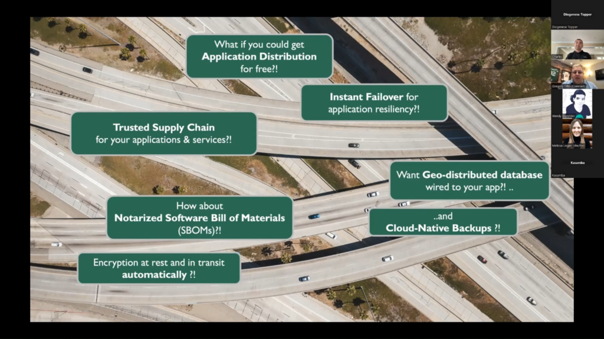
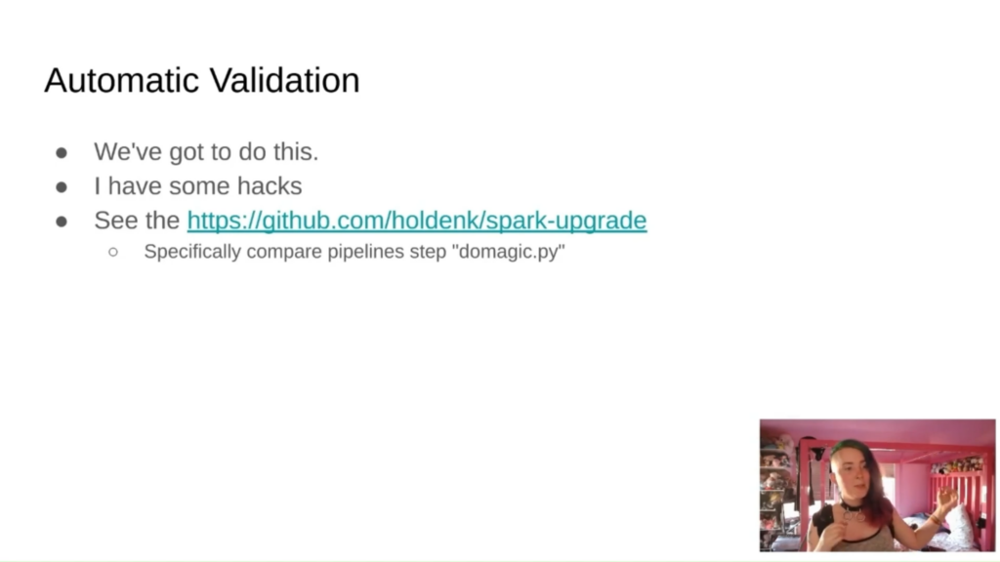

*A summary of our discussion during our first DoKC Town Hall held in May: Improved DevX with DoK and best practices for deploying Spark on Kubernetes*

We held our first-ever community Town Hall on Thursday, May 18. Hosted by the Data on Kubernetes Community (DoKC), [Town Halls](https://www.meetup.com/data-on-kubernetes-community/) allow our community to meet one another, share end user journey stories, discuss DoK-related projects and technologies, and learn more about community events and ways to participate.

**Kubernetes Operators**

We started our inaugural event by recapping our [community meetup and operator panel during Kubecon + CloudNativeCon 2023](/blog/data-on-kubernetes-community-at-kubecon-europe-2023/) in Amsterdam. We followed with updates and announcements about our Kubernetes operator Special Interest Group (SIG). The Operator SIG meets every other week and maintains conversations through the DoKC [#operatorSIG Slack channel](https://dokcommunity.slack.com/archives/C04BZFUT7FS).

Operators are one of our favorite topics in the Data on Kubernetes community; they are widely used to help manage databases on K8s. For background, Kubernetes operators are user-defined extensions that can use custom resources to manage applications. They offer a way to package, deploy, and manage an application by extending the functionality of the Kubernetes API.

Operators are in wide use as running data workloads on K8s becomes more widely adopted; however, they come in varying degrees of maturity and can be challenging t o efficiently manage. One of the core missions of DoK Operator SIG is to understand these challenges and propose projects to help. Some of the ways we aim to achieve this include:

- A whitepaper in collaboration with the CNCF Storage TAG to describe the patterns of running databases on Kubernetes - coming soon!
- An operator feature comparison matrix
- An operator security and hardening guide that defines and solves security issues
- A distributed systems operator interface [new!]
- A roundtable discussion for people who write operators

For more details and to get involved, join our [#sig-operator channel](https://dokcommunity.slack.com/archives/C04BZFUT7FS) on the DoKC Slack channel.

**DoK @ Comcast**

[Greg Otto](https://www.linkedin.com/in/gregoryotto/), Executor Director of DevX Platforms at Comcast, spoke about delivering business outcomes and improving DevX with data services running on Kubernetes.

Before running their data services on K8s, it would take the Comcast team two months–or 300 hours–to create a single new data service. After deploying on K8s, they reduced that time to 30 minutes while removing the need for secrets and password management. Developers now have time on days 1 and 2 to scale, upgrade, and manage traffic, and they’ve gained other benefits, which Otto outlined in the slide below.

Comcast now runs thousands of data services on Kubernetes. The team is still early in its journey, so Otto asked one of his developers to explain more about the “human element” of this work.

[Charles Ju](https://www.linkedin.com/in/charles-yiqing-ju-b753b811/), Principal Engineer of Technology Operations at Comcast, spoke about Comcast’s transformation on Kubernetes from a developer’s perspective, citing challenges with the current single cluster deployment model, including availability and performance. Geodistrubuted data on Kubernetes is uncharted territory, so Ju’s team is developing custom controllers for multi-cluster database deployment and cross-cluster communication.

Only some of his teammates have a background in K8s, so the learning curve has been steep. They are still testing their methods, running benchmarks to see if running databases on Kubernetes will give them the performance required for large deployments. However, they are impressed with the economic efficiency, and Ju remains optimistic about running data on K8s.

**DoK + Apache Spark**

[Holden Karau](https://www.linkedin.com/in/holdenkarau/), Spark Committer and Open Source Engineer at Netflix, shared her experiences and best practices for deploying Apache Spark on K8s. These include:

- Blob storage
- Decommissioning resources
- Setting up ownership links between the driver and dependent resources
- Dynamic prioritization of resources
- Automatic validation of performance

She also recommends deploying Spark directly (using a K8s operator for dynamic allocation flexibility). However, using an operator can make the lifecycle much easier to understand, which also has benefits.

**Wrap Up**

At the end of the event, we hosted a quiz on DoK. Congrats to [Robert Hodges](https://www.linkedin.com/in/berkeleybob2105/), CEO of Altinity, for winning the quiz and a RUN DOK T-shirt!

The DoKC thanks our [sponsors](/sponsors/), speakers, and attendees for making the inaugural Town Hall event a valuable experience!

To watch the replay, click [here](https://youtu.be/3OeM43VE3KE).

**Interested in Learning More?**

[Town Hall meetings](https://www.meetup.com/data-on-kubernetes-community/events/) will be held the third week of each month. Register for our June event [here](https://www.meetup.com/data-on-kubernetes-community/events/293604002/); topics will include ELT architectures, moving data workloads from AWS Glue into Kubernetes, and how operators can help protect against security threats to cloud-native databases. Also, if there are any topics you would like covered in future events, please let us know!

**Data on Kubernetes Community**

[Website](/) | [Slack](@slack) | [LinkedIn](https://www.linkedin.com/company/data-on-kubernetes-community/) | [YouTube](https://www.youtube.com/channel/UCUnXJbHQ89R2uSfKsqQwGvQ) | [Twitter](https://twitter.com/DoKcommunity) | [Meetups](https://www.meetup.com/data-on-kubernetes-community/)

**Operator SIG**

#sig-operator on [Slack](@slack) | Meets every other Tuesday
