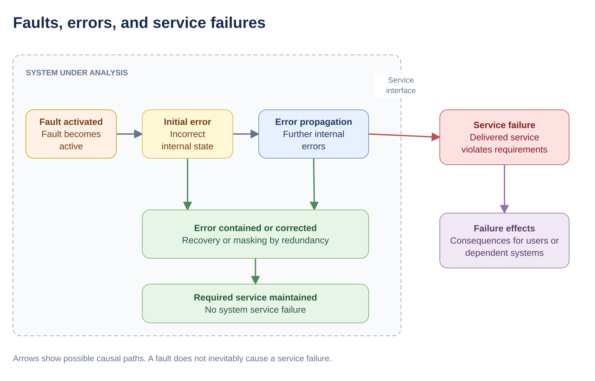
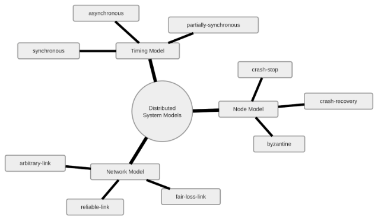
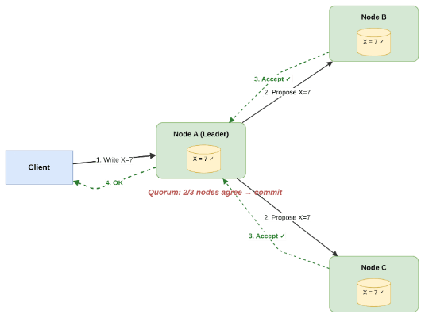
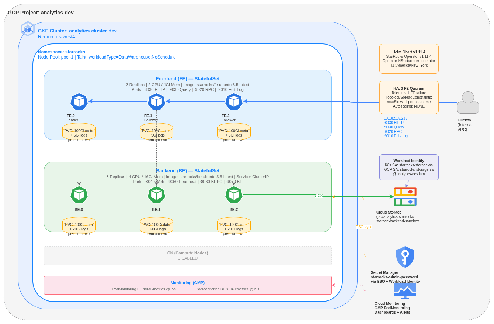
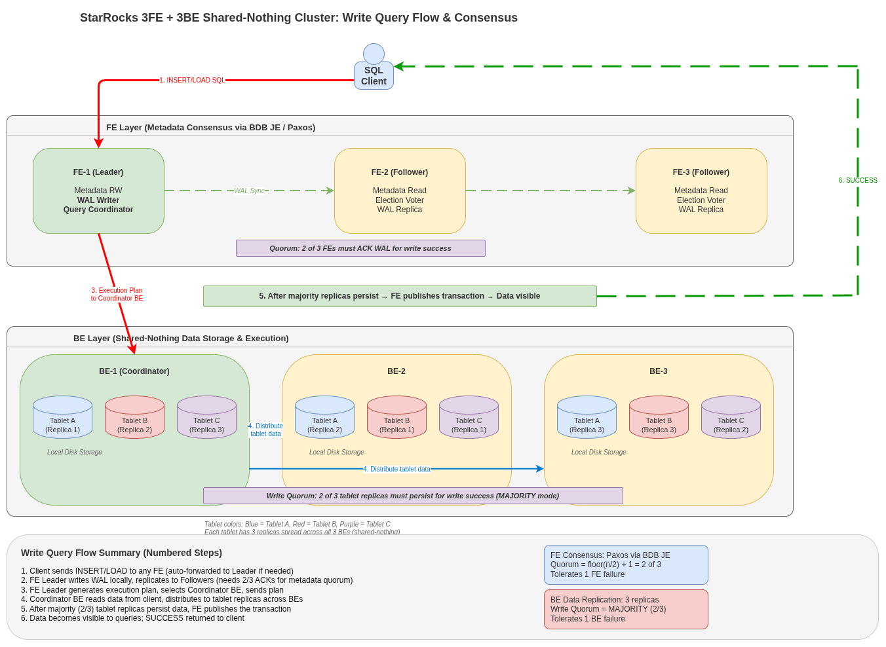

> This is a two-part series on performing FMEA to test production readiness of Starrocks on GKE.

## Introduction

In May 2026, I assessed whether a customer could self-host StarRocks on Google Kubernetes Engine (GKE). I wanted to know which failures the deployment could tolerate and what recovering from them would take.

We used [*Failure Modes and Effects Analysis*](https://www.youtube.com/watch?v=Z9Kz4znKgcM) (FMEA) to identify how the deployment could fail, trace the effects, and decide what to test. This is Part 1 of the series that covers the deployment, its quorum requirements, and how we designed the assessment. In Part 2 we will see the tests in action and what we found.

## Audience and Key Takeaways

This series is for SREs, Kubernetes administrators, and engineers evaluating a stateful system for production. You’ll learn what to understand about the system upfront, how to turn the guarantees your workload depends on into test cases, and how to scope the work to the time and resources you have. The series uses [StarRocks](https://starrocks.io), an open-source analytical data warehouse, as a case study and walks through the FMEA basics in enough depth to apply them to other stateful systems.

## What Is FMEA and Why Use It?

Failure Modes and Effects Analysis (FMEA) is a structured way to identify how a system can fail, understand the consequences, and decide how to prevent, detect, or recover from those failures. For a distributed database, it helps us examine our assumptions about availability and recovery before a production outage puts them to the test.

We often evaluate databases with stress tests and benchmarks such as [YCSB](https://en.wikipedia.org/wiki/YCSB) or [TPC-C](https://www.tpc.org/tpcc/). These tell us how the system performs under load. Operational resilience raises a different set of questions. What happens if the leader disappears during a write? Can a restarted member rejoin? What does the client see when a partition leaves the cluster without quorum?

For the readers who remain up-to-date with latest Cloud Native tech, would be aware of another term Chaos Engineering, which is very similar to FMEA, but has a very different focus altogether. We will avoid that rabbit hole for the time being. FMEA and Chaos Engineering share very similar goals in very different manner, in details, we wish not to discuss here.

Testing every possible failure is rarely practical. I started with the guarantees our deployment depended on, then picked scenarios that could challenge each one. We ran those experiments directly because the scope was small. For a larger assessment, a framework like [Jepsen](https://jepsen.io/) can automate parts of the work.

## FMEA Terminology

Before describing the tests, let’s define five terms:

| Term | Meaning |
|----|----|
| **Fault** | A cause of an incorrect system state, such as a software defect, hardware malfunction, or misconfiguration. |
| **Error** | An incorrect internal state that can lead to a failure. |
| **Failure** | An event in which a component or system stops providing its required service. |
| **Failure mode** | The specific way it fails, for example, rejecting writes, returning incorrect results, or failing to start. |
| **Failure effect** | The consequence of that failure for other components, users, or the wider system. |

A fault can produce an error. If that error affects the service delivered, a failure occurs. Faults do not inevitably cause failures: redundancy or error handling may contain them. [Dependability terminology](https://www.landwehr.org/2004-aviz-laprie-randell.pdf)

### Example: insufficient braking in a bike

Suppose a motorcycle’s brake linings are worn beyond their service limit. When the rider brakes to avoid another vehicle, the motorcycle cannot slow sufficiently and collides.

- **Fault:** Excessively worn brake linings.
- **Failure mode:** Insufficient braking force when the brakes are applied.
- **Failure:** The braking system cannot deliver the required deceleration.
- **Effects:** A collision, potentially causing injury, death, or vehicle damage.

The failure mode describes **how the braking system fails**; the effects describe **what happens as a result**. FMEA traces these consequences through the wider system. [NASA FMEA guidance](https://swehb.nasa.gov/pages/viewpage.action?pageId=103776712)



## Why Use FMEA for Databases on Kubernetes?

FMEA helps identify how a database deployment can fail, how those failures affect users, and what the team needs to prevent or recover from them. It provides a structured way to examine questions such as:

1.  **What can fail, and what is the impact?**\
    What happens during pod eviction, node loss, network partitions, storage failures, or credential rotation? Which failures degrade service, interrupt writes, or require manual intervention?
2.  **Under what conditions do the expected guarantees hold?**\
    Which replication settings, quorum requirements, placement rules, and shutdown procedures are necessary to preserve availability and data correctness?
3.  **Can the system recover?**\
    Can failed members restart and rejoin automatically? When is operator intervention required? Which scenarios require backups, and have the relevant restore procedures been tested?
4.  **What operational work does the deployment require?**\
    Which backup schedules, maintenance tasks, alerts, and runbooks must the team maintain? How should upgrades and configuration changes be performed?
5.  **What must applications handle?**\
    How should clients respond to timeouts, connection loss, temporary unavailability, or writes whose outcome is unknown? Which assumptions need explicit tests?
6.  **Which fault injection experiments should we run?**\
    FMEA helps prioritize scenarios, define expected behavior, and establish recovery criteria for controlled experiments.

The resulting analysis gives developers and on-call engineers a concrete record of failure risks, required controls, tested behavior, and unresolved assumptions.

## Distributed System Models and Quorum



System models define the assumptions we make about process failures, communication, and timing. For a database deployment, these assumptions help explain how many unavailable members it can tolerate, what happens during a partition, and what recovery requires.

### Node / Process Models

These models describe how a process can fail. In Kubernetes, the database process runs inside a container within a pod; restarting that container does not necessarily restore the database member to a usable state.

| Model | Behaviour |
|----|----|
| **Crash-stop** | A process stops executing and never resumes. The remaining members must operate without it. |
| **Crash-recovery** | A process can stop and later restart. Its memory state is lost, while persisted state may survive. |
| **Byzantine** | A process can behave arbitrarily, including sending incorrect or contradictory messages to other members. |

These are assumptions about process behaviour, not Kubernetes workload types. [Distributed systems lecture notes](https://www.cl.cam.ac.uk/teaching/2122/ConcDisSys/dist-sys-notes.pdf)

`CrashLoopBackOff` indicates repeated container failures with delays between restart attempts. It does not represent crash-stop behaviour or guarantee that the database has failed safely. [Kubernetes pod lifecycle](https://kubernetes.io/docs/concepts/workloads/pods/pod-lifecycle/)

Similarly, competing leaders during a network partition do not automatically imply Byzantine behaviour. They may result from lost communication, stale leadership information, or an incorrect coordination mechanism.

### Network Models

Network models describe what processes can assume about message delivery.

| Model | Behaviour |
|----|----|
| **Arbitrary link** | Messages may be lost, altered, fabricated, or delivered unpredictably. |
| **Fair-loss link** | Messages may be lost. If correct processes keep retransmitting, the link cannot discard every transmission forever. |
| **Reliable link** | Messages between correct processes are eventually delivered without fabrication or duplicate delivery at the abstraction’s interface. Delivery has no fixed time bound. |

Reliable delivery can be built over fair-loss links using retransmission and duplicate suppression, subject to the model’s assumptions. A permanent partition prevents delivery regardless of retries. [Distributed systems lecture notes](https://www.cl.cam.ac.uk/teaching/2122/ConcDisSys/dist-sys-notes.pdf)

For database clients, a timeout leaves another question: did the operation fail, or did its response fail to arrive? Retrying a request therefore requires understanding its transaction and duplicate-handling semantics.

### Timing Models

Timing models describe the bounds an algorithm can assume for process execution and communication.

| Model | Behaviour |
|----|----|
| **Synchronous** | Known upper bounds exist for processing and message-delivery delays. |
| **Asynchronous** | The algorithm cannot rely on fixed upper bounds for processing or message-delivery delays. |
| **Partially synchronous** | Bounds exist but are unknown, or known bounds become valid after an unknown stabilization time. |

Partial synchrony is not simply a mixture of synchronous and asynchronous operations. It describes the timing assumptions under which a protocol must remain correct and eventually make progress. [Dwork, Lynch, and Stockmeyer](https://groups.csail.mit.edu/tds/papers/Lynch/jacm88.pdf)

A delayed response cannot always distinguish a failed process from a slow or unreachable one. This is why timeouts, leader elections, and recovery behaviour matter when operating a distributed database.

## Consensus, Quorum, and Reconciliation

Distributed systems often run the same service or store copies of the same data across multiple machines, commonly called **nodes**.

This improves availability and fault tolerance. If one node becomes unavailable, another may continue serving requests.

However, distributing data across multiple nodes introduces an important challenge: **how do we ensure that these nodes agree on the state of the system, especially when some of them fail?**

Three important concepts help us understand this problem: **Consensus, Quorum, and Reconciliation.**

### Understanding the three concepts



Imagine a distributed system with three nodes: A, B, and C. Each node maintains a copy of a value called `x`.

Suppose the value of `x` changes from `10` to `20`. We want the system to agree on this change, even if one of the nodes becomes unavailable.

This introduces three related but different concepts.

**1. Consensus = How do nodes agree on a decision?**

Consensus is the process through which nodes in a distributed system agree on a decision or value, even when some nodes fail or become unreachable.

Think of it as a voting process. Nodes follow a set of rules to decide which proposed changes can be accepted.

For example, nodes A, B, and C might participate in a consensus protocol to decide whether a particular update should be committed.

**2. Quorum = How many nodes need to participate?**

A quorum is the minimum set of participants required to satisfy a protocol's rules for making a decision or completing an operation.

For example, a system with three voting nodes might require at least two of them to participate before committing a change.

This is called a **majority quorum**.

However, quorum and consensus are not the same thing. Quorum defines a participation requirement, while consensus defines the rules that allow nodes to safely agree on decisions.

**3. Reconciliation = How do we bring nodes back into sync?**

Reconciliation is the process of detecting differences between the actual and expected states of a system and taking corrective action.

For example, suppose A and B have successfully committed the new value `x = 20`, but C was temporarily unavailable and still stores `x = 10`.

When C becomes available again, it needs to catch up with the committed changes.

This is an example of reconciliation.

Reconciliation does not always require consensus. Some systems reconcile against a known desired state, while others use replication logs, version information, or other mechanisms to repair differences.

In simple terms:

- **Consensus:** Agree on what should happen.
- **Quorum:** Determine how many participants are required.
- **Reconciliation:** Bring the system's state into agreement with the accepted or desired state.

These concepts often work together, but they solve different problems.

### Understanding Majority Quorum

Different distributed systems use different quorum rules. For simplicity, we'll focus on **majority quorum**, commonly used in leader-based consensus protocols.

For a system with (N) voting members, a majority quorum requires:

**Q = ⌊N / 2⌋ + 1**

Here, (N) represents the total number of voting members, and (Q) represents the minimum number needed for a majority.

Consider three nodes: **A, B, and C**.

Since there are three voting members, the majority is two.

If A is the leader and proposes a change, it needs acknowledgment from at least one other voting member to satisfy a majority-based replication requirement.

Now consider a few situations:

- **C becomes unavailable:** A and B can still form a majority.
- **A becomes isolated:** A cannot form a majority on its own. Depending on the consensus protocol, B and C may elect a new leader and continue operating.
- **Both B and C become unavailable:** A is the only remaining node and cannot form a majority.

This is why a three-node voting group can tolerate one unavailable member while retaining a majority.

The following table shows how this works for different cluster sizes.

| Voting members | Majority required | Unavailable members tolerated |
|----------------|-------------------|-------------------------------|
| 2              | 2                 | 0                             |
| 3              | 2                 | 1                             |
| 4              | 3                 | 1                             |
| 5              | 3                 | 2                             |

Notice something interesting: **a four-node cluster cannot tolerate more unavailable voting members than a three-node cluster.**

Adding another voting member does not always improve fault tolerance.

For a majority-based system to tolerate (f) unavailable members, the total number of voting members must satisfy:

**N ≥ 2f + 1**

For example, to tolerate two unavailable members, we need at least five voting members.

An important property of majority quorums is that any two majorities must overlap by at least one member.

Consensus protocols combine this property with additional rules for leader election, voting, and replication to preserve consistency.

**Note:** These examples assume crash failures and sufficient communication between surviving nodes. A majority alone does not guarantee correctness or availability under every type of failure.

## Designing Our StarRocks Deployment



I deployed **StarRocks 3.5 in shared-nothing mode on GKE** using the StarRocks Kubernetes Operator, with three Frontend (FE) and three Backend (BE) nodes.

| Component         | Configuration                                      |
|-------------------|----------------------------------------------------|
| **Region**        | `us-west4`                                         |
| **Frontends**     | 3 FEs (1 leader, 2 followers)                      |
| **Backends**      | 3 BEs                                              |
| **Workloads**     | StatefulSets with persistent volumes               |
| **FE resources**  | 2 CPUs, 4 GiB RAM, 100 GiB metadata storage        |
| **BE resources**  | 4 CPUs, 16 GiB RAM, 100 GiB data storage           |
| **Storage class** | `premium-rwo`                                      |
| **Placement**     | Topology spreading by hostname (1 GKE Node-per-AZ) |
| **Replication**   | 3 replicas, majority write quorum                  |

StarRocks separates responsibilities between two components:

- **Frontends (FEs):** Manage metadata, client connections, and query planning.
- **Backends (BEs):** Store data and execute queries.

Both components use replication, but their quorum requirements serve different purposes.

Reference: [StarRocks Architecture](https://docs.starrocks.io/docs/3.5/introduction/Architecture/)

### Frontends: Consensus for Metadata

FEs maintain database metadata, including information about tables, partitions, and schemas. StarRocks uses **Berkeley DB Java Edition (BDB JE)** for metadata replication and leader election.

There are three FE roles:

| Role         | Responsibility                                    |
|--------------|---------------------------------------------------|
| **Leader**   | Coordinates metadata changes                      |
| **Follower** | Replicates metadata and participates in elections |
| **Observer** | Replicates metadata without voting                |

Our deployment had **three voting FEs (including the leader)**, requiring a majority of two.

**N = 3, Q = 2**

This means:

- **One FE fails:** The remaining two can maintain a majority and continue quorum-dependent operations. If the leader fails, they can elect a new one.
- **Two FEs fail:** The remaining node cannot form a majority, preventing new metadata commits that require quorum.

Observer FEs do not count toward the voting majority.

Reference: [StarRocks Metadata Recovery](https://docs.starrocks.io/docs/administration/Meta_recovery/)

### Backends: Quorum for Tablet Writes

Unlike FE metadata replication, Backend write quorum operates **at the tablet level.**



#### What is a Tablet?

A **tablet** is the basic unit of data storage, distribution, and replication in StarRocks.

Instead of storing an entire table on one machine, StarRocks divides its data into smaller units called tablets, organized through partitions and buckets.

Each tablet can have multiple replicas stored on different Backend nodes.

For example, with three BEs and `replication_num = 3`:

| Tablet   | BE-A    | BE-B    | BE-C    |
|----------|---------|---------|---------|
| Tablet 1 | Replica | Replica | Replica |
| Tablet 2 | Replica | Replica | Replica |
| Tablet 3 | Replica | Replica | Replica |

This allows StarRocks to distribute query processing and maintain redundant copies of data.

#### Tablet Replication and Write Quorum

Two table properties determine replication and write acknowledgment requirements:

- **`replication_num`:** Number of replicas maintained per tablet.
- **`write_quorum`:** Number of replicas required to acknowledge a write.

StarRocks supports three write quorum policies:

| Policy     | Required acknowledgments (3 replicas) |
|------------|---------------------------------------|
| `ONE`      | 1                                     |
| `MAJORITY` | 2                                     |
| `ALL`      | 3                                     |

Our tables used:

```text
"replication_num" = "3",
"write_quorum" = "MAJORITY"
```

Therefore, **at least two replicas of each affected tablet must acknowledge a write**.

If one BE fails, the remaining two replicas can still satisfy the majority write quorum. If two replicas of a tablet become unavailable, writes to that tablet cannot meet the configured quorum.

Reference: [StarRocks Replica Management](https://docs.starrocks.io/docs/administration/management/resource_management/Replica/)

### Zooming Out

Our StarRocks deployment had two independent quorum requirements:

|   | FE metadata quorum | BE write quorum |
|----|----|----|
| **Purpose** | Metadata consistency and leader election | Replicated tablet writes |
| **Participants** | Voting FE nodes | Tablet replicas |
| **Required majority** | 2 of 3 FEs | 2 of 3 replicas |
| **Failure tolerance** | 1 voting FE | 1 replica per tablet |

A healthy FE majority cannot compensate for missing tablet replicas, and healthy tablet replicas cannot replace the FE majority required for metadata operations.

When failed nodes return, replication and recovery mechanisms help bring their state up to date.

This connects back to our three concepts: **Consensus establishes agreement, quorum defines the required participation, and reconciliation restores the expected state.**

## Designing the FMEA

I started with the guarantees I expected from our StarRocks deployment on GKE. For each guarantee, I picked a failure that could put it under pressure and decided what evidence would count as a pass. That gave me three things to check in each scenario:

- **Safety.** Can an isolated FE commit a metadata change without a voting majority? Can a load be reported as successful when an affected tablet has too few replica acknowledgments?
- **Availability.** Which operations can clients still perform while the fault is active? Can they submit new loads, or do they see errors and timeouts during the disruption?
- **Recovery.** Can the affected member restart, rejoin, and restore the intended redundancy? If recovery requires an operator, what intervention is needed?

I assessed the FE metadata quorum and the BE tablet write quorum separately. In our deployment, each had a threshold of two out of three, but they counted different things. The FE check concerned voting members that could communicate and participate in metadata consensus. The BE check concerned successful write acknowledgments from replicas of **each affected tablet**. A load succeeding while one BE was unavailable could demonstrate continued write availability. Recovery required a separate check that the BE rejoined and its replicas became healthy again.

I grouped the scenarios by what could go wrong and what I expected to observe.

<table>
<colgroup>
<col style="width: 25%" />
<col style="width: 25%" />
<col style="width: 25%" />
<col style="width: 25%" />
</colgroup>
<thead>
<tr>
<th>Scenario</th>
<th>What could go wrong</th>
<th>What I would check</th>
<th scope="col">Expected Working Model</th>
</tr>
</thead>
<tbody>
<tr>
<td><strong>FE follower or leader pod disappears</strong></td>
<td>The FE group loses a member, and losing the leader can interrupt metadata operations.</td>
<td>Check whether the remaining voters retain a majority, whether they elect a new leader when needed, and whether the replacement FE rejoins.</td>
<td>Crash Recovery must happen.</td>
</tr>
<tr>
<td><strong>A GKE worker is drained or abruptly replaced</strong></td>
<td>A member may fail to recover after its pod is replaced, even when its persistent volume survives.</td>
<td>Treat planned drain and abrupt loss as separate cases. Check whether the replacement starts with usable state and returns to database membership.</td>
<td><ul>
<li>No Byzantine Behaviour.</li>
<li>Crash Stop if Metadata Corrupted.</li>
</ul></td>
</tr>
<tr>
<td><p><strong>An FE is isolated from its voting peers</strong></p>
<p><strong>(Network Partition)</strong></p></td>
<td>An isolated leader could keep acting on stale leadership information, or clients could continue sending requests to an unreachable member.</td>
<td>Check whether the majority can elect or retain a leader, whether the isolated side can commit new metadata changes, and whether the isolated member rejoins after connectivity returns.</td>
<td><ul>
<li>No Byzantine Behaviour</li>
</ul></td>
</tr>
<tr>
<td><strong>A BE becomes unavailable</strong></td>
<td>An affected tablet may have too few healthy replicas to satisfy its write quorum.</td>
<td>Check whether loads can succeed with the remaining replicas and whether the cluster restores the intended replica count after recovery.</td>
<td><ul>
<li>Crash Recovery must happen</li>
</ul></td>
</tr>
<tr>
<td><strong>BEs restart after a credential change</strong></td>
<td>Existing members may keep serving while a replacement fails to authenticate with stale credentials.</td>
<td>Restart one member first and check whether it can register. Assess what happens to write availability if further members restart before the first recovers.</td>
<td><ul>
<li>No Byzantine Behaviour. </li>
<li>Crash Recovery is expected.</li>
</ul></td>
</tr>
</tbody>
</table>

For each scenario, I wanted evidence at three levels: what the client saw, what StarRocks reported about leadership and replica health, and what Kubernetes reported about pod lifecycle. A replacement pod could be running while its database member was still unable to register or serve traffic. A rejected load could also be the expected safety outcome when the required quorum was unavailable.

I started with one disruption at a time so I could trace its effects. Then I paired changes that can occur together during routine operations, such as rotating credentials and later replacing a pod. That distinction shaped the FMEA because a deployment can look healthy immediately after a change and still fail the next time a member has to start from scratch.

## What's Next

In Part 2, we will define the in-variants from the FMEA Design shown above. I will provide running Terraform Samples and demo you can try out on your own.
