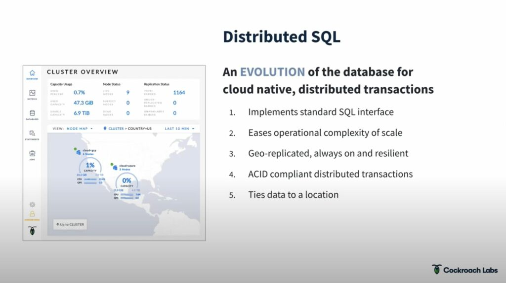
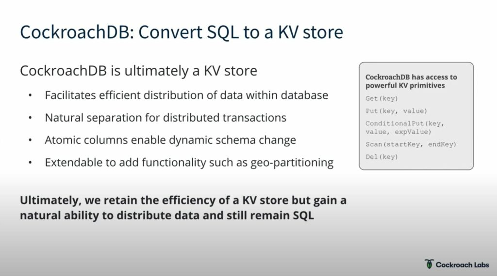
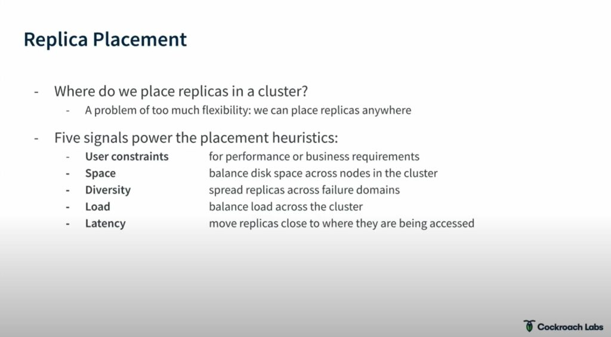
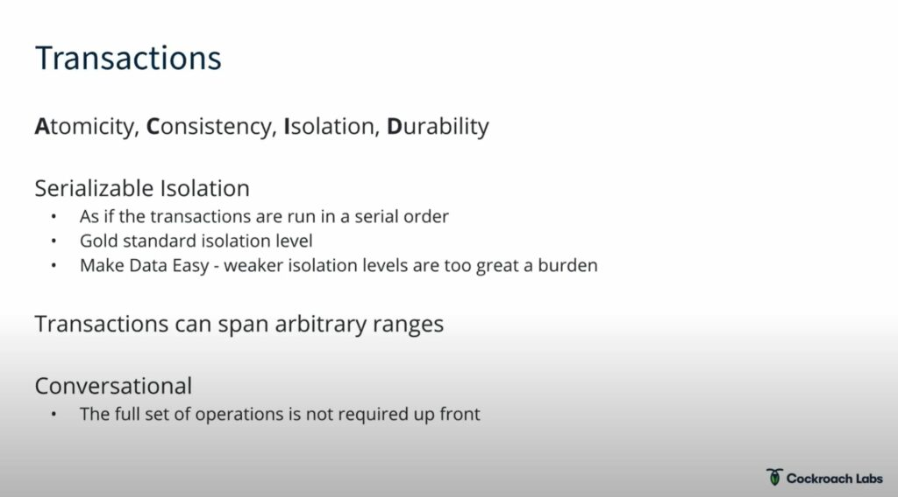
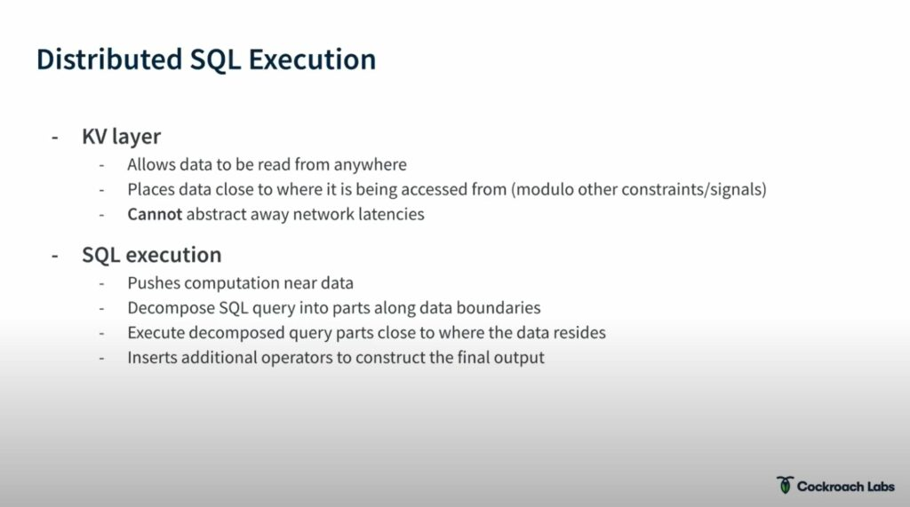
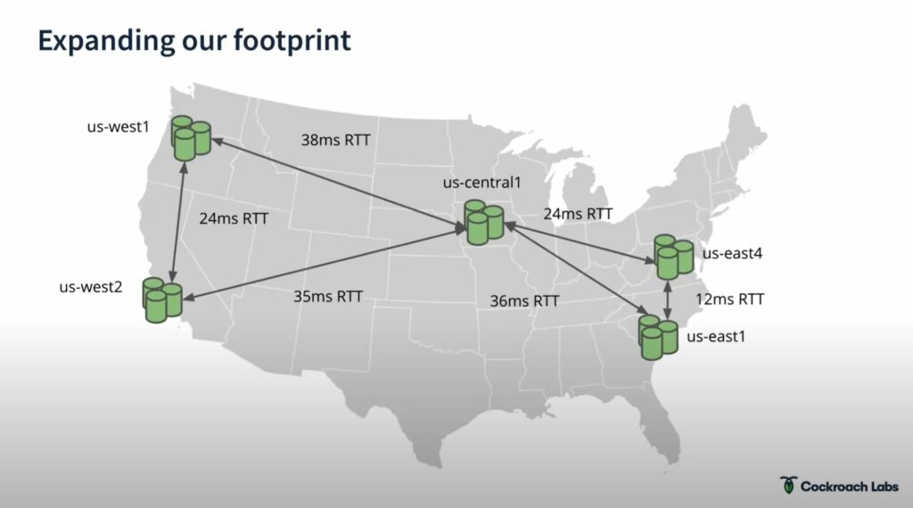
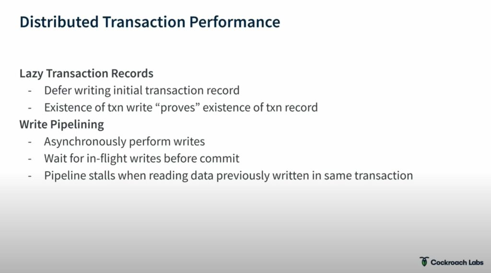
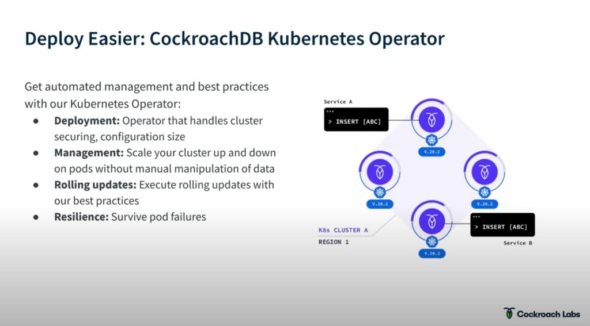

Even though 2020 is over an 2021 brings a great deal  of optimism and Hope not that much has changed apart from the changing of the calendar year. So many people still have Zoom meetings to attend to, children to take care of in the next room and a beautiful constellation of responsibilities that only a person who works from home has to deal with, so it's totally understandable that you didn't have time to check out  one of the latest meetups that we held here at Data on Kubernetes.  But fear not, in this article we will give you the lowdown on what was discussed, a summary with the key points of everything you need to know about the key points of the cockroach DB presentation. In case you have some time, and you like to watch up just follow the [link](https://www.youtube.com/watch?v=if8RkxvFZtA&feature=emb_logo).

# The **protagonists**:

                              [Jim Walker](https://www.linkedin.com/in/jwwalker/)                                       [Keith McClellan](https://www.linkedin.com/in/keithmcclellan/)                                    [Lisa-Marie Namphy](https://www.linkedin.com/in/lnamphy/)

# **Plot:**

Jim took the reins to **explain** the **architecture of a distributed system** not so much from the Kubernetes angle, but more from the angle of what his team had to go through at Cockroach Labs, that way trying to help the rest of us **build better distributed systems**.

# **Key points:**

## What are the **advantages of a distributed database**?

The age of cloud scale and advent of microservices requires a new approach for the relation, transactional database.

## **Characteristics** of the **database** that has evolved for **cloud native**, distributed transactions.

In the case of CockroachDB it is a **relational** database, managed by

**RAFT, scales** across multiple **regions**, **clouds** or even **k8s clusters**. It is naturally **resilient** any node can go done and the db will be just fine.

Data can be geolocated, great news for edge computing.

***Fun fact:*** *any node is an entryway into the logical db.*

## **Ranges: SQL to KV**

**Problem****:**

The old way of storing data doesn’t work for a distributed database, continually appending new data that would then be indexed in alphabetical order. In distributed systems we would have a very hard to parsing that index system and wouldn’t be able to find where data lives very easily.

**Solution**:

##

## **Raft**

Along with [Paxos](https://en.wikipedia.org/wiki/Paxos_(computer_science)), [Raft](https://en.wikipedia.org/wiki/Raft_(algorithm)) is one of the core algorithms that is driving distributed systems.

Raft was used in the cockroachDB system over Paxos for simplicity reasons.

***Fun fact:*** *It took Jim 5 years to build a production ready RAFT algorithm*

## **Distributed Data: Range Distribution, Scale and Resilience**

***Fun fact****: Jim likes to talk about the Cockroach Labs* [*documentation team*](https://www.cockroachlabs.com/docs/stable/)*, and the word “Latency”.*

##

## **Distributed Transactions**

*“Transactions are tough, the corner cases will get you” -* ***Jim***

What’s [ACID](https://pt.wikipedia.org/wiki/ACID)?

##

## **Distributed SQL Execution**

Able to utilize a [cost based optimizer](https://jaceklaskowski.gitbooks.io/mastering-spark-sql/content/spark-sql-cost-based-optimization.html) + location.

##

## **Distributed Latency**

Of course our DB is no longer in the backroom of the office it is distributed, therefore  latency becomes a big issue.

To counteract this CockroachDB fires up multiple clusters in different regions to deal with any query.

## **Distributed Performance Optimizations**

*For a deeper dive check out there* [*SIGMOD paper*](https://www.cockroachlabs.com/guides/cockroachdb-the-resilient-geo-distributed-sql-database-sigmod-2020/) *(**White paper for* *The Resilient  Geo-Distributed SQL Database*

##

## **Deploy CockrochDB easily using the** [**Kubernetes operator**](https://github.com/cockroachdb/cockroach-operator) **they developed**

