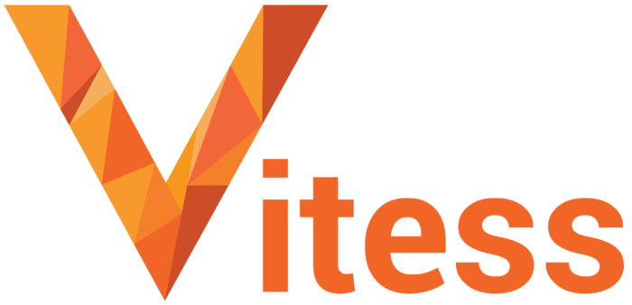

The Data on Kubernetes Community is excited to announce the addition of [Vitess](https://vitess.io/) as its newest [Community Collaborator](/dokc-community-collaborator/). Vitess is an open-source database clustering system that helps scale MySQL databases horizontally through sharding while maintaining MySQL compatibility and handling connection pooling, query routing, and automated failover. It was originally developed by YouTube/Google to solve their MySQL scaling challenges, and it has become particularly well-suited for Kubernetes environments because it was designed to run in containerized environments

## Vitess's Long History with Kubernetes

We recently hosted Vitess project lead, Deepthi Sigireddi, for a DoK Talk about [Vitess’s evolution over the years](https://www.youtube.com/live/GoDUAEAbeNE?si=2yTnzvb8kTbC48rX). Vitess is deeply rooted in open source values and is one of the earliest adopters running data on Kubernetes. In fact, it was developed to run on Borg, the precursor to Kubernetes and started running in Kubernetes in 2015.

According to past DoK reports, databases are the #1  data workloads that organizations run on Kubernetes making Vitess the perfect fit as a DoK Community collaborator. As a community collaborator, Vitess joins Apache YuniKorn and Rook as a partner to the DoK Community. The goal of the program is to foster collaboration across the many open source projects in the DoK ecosystem.

## Collaborate with DoK

Do you work on an open source project in the DoK ecosystem? Let’s collaborate! In addition to our monthly town halls, we feature speakers from various open source projects in our DoK Talk series. Get involved in leading the conversation and join the DoK SIG on our Slack group. Send us a message at community@dok.community
